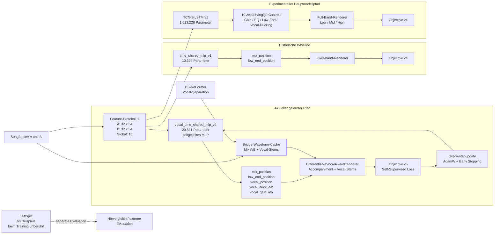

# Aktuelle Form der ML-Modelle

_Stand: 2026-08-21_

Diese Übersicht trennt den aktuell verwendeten Modellpfad von den historischen
Baselines und dem bereits implementierten, aber noch experimentellen größeren
Modell. Sie beschreibt den verifizierten Code- und Run-Stand; ein niedrigerer
Validation-Proxy-Loss ist dabei kein Hörqualitätsnachweis.

## Architektur und Lernpfad



Der aktuelle Default ist der Vocal-aware-Pfad. Die Waveforms und Vocal-Stems
sind zusätzliche Inputs für Renderer und Objective, nicht direkte Eingaben des
MLP. Das Netz arbeitet ausschließlich auf den Feature-Tensoren und erzeugt
zeitabhängige Kontrollen für 32 Halbbeat-Positionen beziehungsweise 31
Intervalle.

## Verifizierter Modellstatus

| Pfad | Architektur / Ausgaben | Run-Stand | Einordnung |
|---|---|---|---|
| **`vocal_time_shared_mlp_v2`** | Zeitgeteiltes MLP mit Hidden-Dimensionen `(64, 32)`; drei monotone Positionen sowie Source-/Target-Vocal-Ducking und resultierende Gains; **20.821 Parameter** | Aktueller RoFormer-Lauf: `output/training_runs/vocal_roformer_extended_bpm145_165_top10_seed20260812/`; 370 Train / 50 Validation; `cuda:0`; Early Stopping nach Epoche 27, bester Checkpoint Epoche 21, Validation-Loss `0,3318392038` | **Aktueller gelernter Pfad / Default** |
| `time_shared_mlp_v1` | Zeitgeteiltes MLP mit `(64, 32)`; `mix_position` und `low_end_position`; **10.394 Parameter** | Historischer Lauf auf 45 Train / 9 Validation; CPU; bester Checkpoint Epoche 8, Validation-Loss `0,2959988448` | Reproduzierbare Baseline; Testsplit ist historisch bereits für Entwicklungsevaluation verwendet |
| `tcn_bilstm_transition_control_v1` | Geteilter TCN-Encoder `54 → 64 → 128`, Fusion `[A, B, A-B, A*B]`, zweilagiger BiLSTM; 10 Full-Band-Controls; **1.013.226 Parameter** | Full-Band-Lauf auf 370 Train / 50 Validation; `cuda:0`; Early Stopping nach Epoche 20, bester Checkpoint Epoche 14, Validation-Loss `0,3206755668` | Implementiert und trainiert, aber **experimentell**, noch nicht als Default |

Der aktuelle Vocal-Lauf verwendet den RoFormer-Stem-Backend
`roformer-model-bs-roformer-sw-by-jarredou`. Dadurch ist
`vocal_time_shared_mlp_v2` das gleiche Modellformat wie zuvor, aber der aktuelle
Trainings- und Featurepfad nutzt die verifizierte RoFormer-Separation. Die 60
Testbeispiele des erweiterten Datensatzes bleiben vom Training ausgeschlossen.

## Additiver Variable-Length-Stand (2026-08-21)

Der neue, nicht als Default aktivierte Pfad
`variable_tcn_bilstm_transition_control_v1` (Modellformat 4) arbeitet mit
homogenen `T=16/32/48/64`-Batches und der separaten Konditionierung
`length_condition = L/8`. Der reale Dataset-v2-Loader wurde ausschließlich für
Train und Validation geöffnet. Ein kurzer CPU-Smoke über alle vier Längen lief
über zwei Epochen; die zweite Epoche wurde sicher aus dem Latest-Checkpoint
resumed. Der Run ist unter
`output/review_variable_v2_training_smoke_20260821_run01/` dokumentiert.

Die Inferenzprüfung eines Validationbeispiels je Länge erzeugte endliche
`(T,10)`-Controls mit exakt monotonen Positionskurven und T=16/32/48/64. Das
ist eine technische Vertragsprüfung, kein Nachweis musikalischer Qualität und
keine lange Trainingskampagne. Der Testsplit wurde in diesem Pfad nicht geladen.
Ein realer v2-Waveform-Cache und ein CLI-Einstieg für einen vollständigen
CUDA-Lauf fehlen noch; der Pfad kann deshalb derzeit nur über die API mit
explizit gelieferten Waveform-Batches gesmoked werden.

## Eingabe, Ausgabe und Constraints des Defaults

```text
features_a      float32 (B, 32, 54)
features_b      float32 (B, 32, 54)
global_features float32 (B, 16)
                         │
                         ▼
                 vocal_time_shared_mlp_v2
                         │
                         ├─ mix_position       (B, 32)
                         ├─ low_end_position   (B, 32)
                         ├─ vocal_position     (B, 32)
                         ├─ vocal_duck_a/b     (B, 32)
                         └─ vocal_gain_a/b     (B, 32)
```

- Die drei Positionskurven haben feste Endpunkte `0/1`, sind konstruktiv
  monoton und verwenden die begrenzte Inkrementtransformation aus
  Control-Protokoll 4.
- Vocal-Ducking ist auf maximal `0,75` begrenzt, an den Übergangsendpunkten
  null und wird zusätzlich durch die Vocal-Position gefenstert.
- Der stem-fähige Renderer verarbeitet den vocalfreien Rest zweibandig und
  addiert die beiden Vocal-Stems mit den gelernten Vocal-Gains.
- Objective v5 liefert das Lernsignal aus Energieform, Boundary-/Glätte-,
  Clipping-/Transienten- und Vocal-spezifischen Termen. Es gibt keine
  Ground-Truth-Control-Kurven.

## Aktuelle Aussagekraft und nächstes Gate

Technisch ist der aktuelle RoFormer-Lauf reproduzierbar materialisiert und der
Best-Checkpoint wurde manifest- und SHA-geprüft geladen. Der Validation-Loss
belegt jedoch nur Lernen gegen den eingefrorenen Proxy. Der nächste fachliche
Gate ist der noch offene geblendete Hörvergleich des gelernten Vocal-v2-
Checkpoints gegen die ungelernte Initialisierung auf fünf vocal-aktiven
Paaren; derzeit liegen dafür `0/5` Ratings vor. Erst danach sollte entschieden
werden, ob Objective-Gewichte, Vocal-Ducking oder die Architektur verändert
werden.

## Quellen im Repository

- Modellimplementierung: [`src/ml/model.py`](../src/ml/model.py)
- Baseline-Vertrag: [`ML_CONTROL_MODEL_PROTOCOL.md`](./ML_CONTROL_MODEL_PROTOCOL.md)
- Vocal-Vertrag: [`VOCAL_CONTROL_MODEL_PROTOCOL.md`](./VOCAL_CONTROL_MODEL_PROTOCOL.md)
- TCN-/BiLSTM-Vertrag: [`TCN_BILSTM_CONTROL_MODEL_PROTOCOL.md`](./TCN_BILSTM_CONTROL_MODEL_PROTOCOL.md)
- Verifizierter Projektstand: [`STATUS.md`](./STATUS.md)

## Verifizierter Real-Cache- und CUDA-Stand (2026-08-21)

Der Variable-Length-Pfad verwendet nun den separaten
`local_grid_target_to_source_v1`-Waveformvertrag und den unveränderlichen
Cache `output/ml_cache/variable_bridge_waveform_v2`. Der reale Datensatz
enthält 420 Train- und 48 Validation-Entries, je 105/12 für 2/4/6/8 Takte;
der Testsplit bleibt geschlossen. Der reale TCN/BiLSTM-Smoke lief mit
`cuda:0` eine Epoche und wurde im selben Run auf zwei Epochen resumed. Beide
Läufe meldeten 468 Cache-Hits; der CUDA-Audit bestätigte die RTX 5070 Ti,
finite Gradienten, Checkpoint-SHAs und Controls mit `T=16/32/48/64` und zehn
Kanälen. Dieser Pfad ist technisch verifiziert, aber weiterhin nicht der
Projekt-Default und kein vollständiger 100-Epochen-Lauf.
