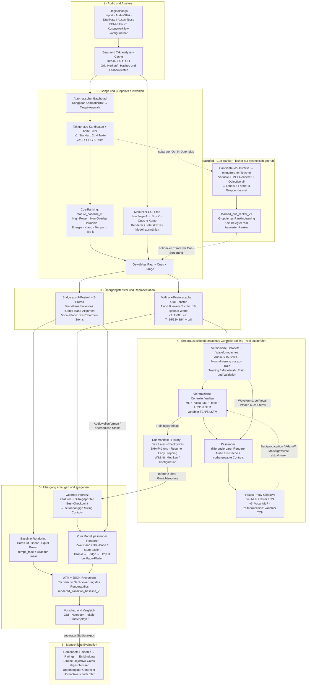
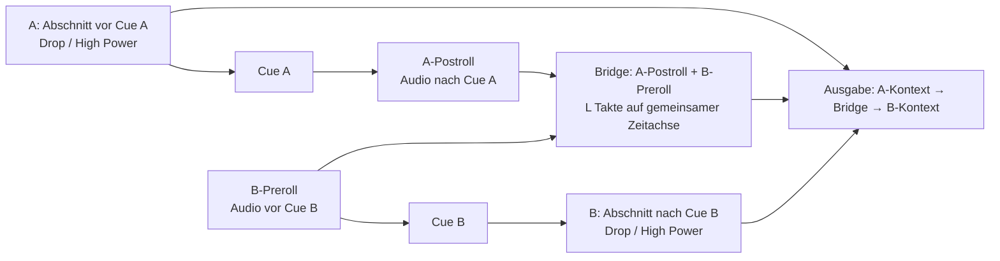

# BeatBridge: Pipeline und Lernpfade

**Druckfähige Einzelabbildungen (28.10.2026):** Die
[SVG-Serie für die Masterarbeit](./figures/flowcharts/README.md) enthält eine
reduzierte Gesamtpipeline und zehn separate Komponentendiagramme mit
englischen Beschriftungen, Caption-Vorschlägen und Quellen.

**Metrikmechanismen (29.10.2026):** Die ergänzenden
[Abbildungen 12–23](./figures/flowcharts/METRICS_README.md) erklären die
Auswahl-Scores, Render-Metrik, Trainings-Losses und Evaluationskennzahlen.

_Stand: 27.10.2026. Aus Repository-Code, Protokollen, Status und der
Ergebnisevidenz rekonstruiert; keine neue Audioverarbeitung oder Trainingsrunde._

Die Grafik ist eine Landkarte der vorhandenen, getrennten CLI-, GUI-,
Trainings- und Studienpfade. Sie beschreibt keinen einzelnen Befehl, der
automatisch alle Zweige ausführt. Der wissenschaftliche Kern ist
**Features → Mixing-Controls → differenzierbarer Renderer → festes
Proxy-Objective**. Die Auswahl der Songs und Cuepoints ist davon getrennt.

Durchgezogene Pfeile zeigen Datenfluss in implementierten Pfaden.
Gestrichelte Pfeile zeigen ausdrücklich beschriftete optionale Verbindungen
oder das Gradientenfeedback. „Real trainiert“ bezeichnet ausgeführte Läufe,
nicht nachgewiesene Hörüberlegenheit. Der Cue-Ranker ist separat als nur
synthetisch geprüft markiert.

## Gesamte Pipeline

## Fenstergeometrie: Was wird tatsächlich gemischt?

Die Fade-Pfade mischen die Übergangsfenster, nicht die beiden angrenzenden
High-Power-Fenster. Der Generator prüft trotzdem vollständige Fenster vor
und nach beiden Cues, damit auch das Ranking die Grenzen beurteilen kann.
Der Hard Cut ist die gesonderte Baseline ohne ausgedehnte Bridge.

Im variablen Waveformcache gilt `local_grid_target_to_source_v1`: Die
**lokale Source-Griddauer** ist maßgeblich. Mix und Vocal von B erhalten
denselben Rubber-Band-Stretch; eine globale BPM-Ratio allein ersetzt diese
Fenstermessung nicht. Die Trainingsarrays haben 11.025 Hz, Stereo und exakt
gleiche Shapes. Größere Längenfehler werden abgewiesen, nicht durch beliebiges
Cropping oder Padding versteckt. Render-/Studienausgaben verwenden üblicherweise
44.100 Hz Stereo.

## Die vier trainierten Controller sind unterschiedliche Pfade

| Modell | Features / Länge | Vorhergesagte Steuerung | Renderer und Lernsignal |
|---|---|---|---|
| `time_shared_mlp_v1` | Protokoll 1; vier Takte; A/B je `(32,54)`, Globals `(16,)` | Monotone Mix- und Low-End-Position | `DifferentiableTwoBandRenderer`; Objective v4 |
| `vocal_time_shared_mlp_v2` | Protokoll 1; vier Takte; gleiche Eingabeformen | Mix-, Low-End- und Vocal-Position; getrenntes Ducking A/B; daraus Vocal-Gains | `DifferentiableVocalAwareRenderer`; vocalfreier Rest zweibandig plus getrennte Vocals; Objective v5 |
| `tcn_bilstm_transition_control_v1` | Protokoll 1; vier Takte; gleiche Eingabeformen | Zehn Controls: Gain A/B, Low-/Mid-/High-EQ A/B, Low-End-Ownership, Vocal-Ducking | `DifferentiableFullBandTransitionRenderer`; drei Bänder; Objective v4. Der generische Trainingspfad nutzt ohne Stems einen Mid-Band-Ducking-Proxy. |
| `variable_tcn_bilstm_transition_control_v1` | Protokoll 2; 2/4/6/8 Takte; A/B je `(T,54)`, Globals `(16,)`, `length_condition=L/8`; T=16/32/48/64 | Tatsächlich gerendert: monotone Mix-/Low-End-/Vocal-Position und Ducking A/B; zusätzlich zehn Diagnosekanäle | `DifferentiableVocalAwareRenderer`; Objective v5 mit tatsächlichem T zeitnormalisiert. **Kein Drei-Band-EQ-Trainingspfad wie beim festen TCN.** |

Das Netz erhält Features, keine rohen Audiosamples. Audio und gegebenenfalls
Stems gehen zusätzlich in Renderer und Objective. Es gibt keine annotierten
Ground-Truth-Controlkurven und keine menschlichen Qualitätslabels als
Controller-Trainingsziel. Das Objective bleibt pro Lauf fest; die Gradienten
ändern die Controllergewichte.

Featurefenster werden aus wiederverwendbaren Volltrack-Featureartefakten an
den Cues extrahiert. Der Bridge-Waveformcache ist ein eigener Datenzweig;
Features werden nicht erst aus dessen auf 11.025 Hz reduzierten
Trainingswaveforms berechnet.

Die beiden TCN-Varianten verwenden einen geteilten A/B-TCN-Encoder und einen
BiLSTM zur zeitlichen Verarbeitung. Der zusätzliche
`variable_time_shared_mlp_v1` ist im Code vorhanden; die gesichtete Evidenz
belegt keinen eigenen realen Trainingslauf. Er gehört deshalb nicht zu den
vier oben als real trainiert ausgewiesenen Familien.

**GUI-Grenze aus dem aktuellen Code:** `SUPPORTED_GUI_MODELS` enthält nur
die drei festen Protokoll-1-Familien. Die Variable-TCN ist damit nicht über
diesen GUI-Modelladapter auswählbar. Die native PySide6-GUI ist implementiert;
der manuelle Abnahmeklicktest bleibt laut Status offen. Die sichtbare
Mehrtrack-Sequenz verwaltet Kanten und deren Vorschauen; daraus folgt noch
kein belegter finaler Gesamtsong-/Projekt-Export.

## Auswahl, Daten und Qualitätsmessung auseinanderhalten

| Stelle | Was sie entscheidet oder misst | Wichtige Grenze |
|---|---|---|
| `song_compatibility_v1` | Welche Targets zu einem Source-Song passen | Vor der Cuepoint-Erzeugung; kein Controller |
| Kandidatengenerator | Welche Kombinationen aus Cues und Taktlänge zulässig sind | Default lehnt approximative/unbekannte Grids ab; vollständige Fenster, Tempoabweichung standardmäßig höchstens 15 %; v2 verlangt lokal 4/4 in den verwendeten Fenstern |
| `feature_baseline_v3` | Welche akzeptierten Cues zuerst gerendert/exportiert werden | Gewichte: High Power 0,30; Non-Overlap 0,30; Harmonie 0,18; Energie 0,10; Klang 0,05; Tempo 0,07 |
| Objective v4 / v5 | Welche Controls den festen Trainingsproxy verbessern | Differenzierbares Lernsignal; kein gelerntes menschliches Qualitätsurteil |
| `rendered_transition_baseline_v1` | Eigenschaften des tatsächlich gerenderten Audios | Energieform 0,30; Grenzglätte 0,30; Harmonie 0,20; Rhythmik 0,20. Separat vom Trainingsobjective. |
| Blinder Hörvergleich | Präferenzen und Kriterienbewertungen der bewertenden Person | Erst vollständige Ratings, dann Entblindung; mehrere Cues eines Trackpaares sind keine unabhängigen Tracktests |

Vortrainierte Separation ist Hilfsanalyse: Standard ist BS-RoFormer;
HT-Demucs bleibt expliziter Vergleichspfad. Daraus folgt kein eigenes Training
des Separationsmodells. Phrasenkanäle sind definiert, aber mit `phrase_valid=0`
deaktiviert; eine verlässlich implementierte Phrasen-/Strukturerkennung oder
ein nachgewiesener Musik-Embedding-Vergleich wird hier nicht behauptet.

Für die PRIVE-v2-Erweiterung existiert ein eigener vorgelagerter Pfad:
Korpusinventar/Recording-Groups → eingefrorene Splitfortschreibung →
splitbewusster Candidate-only-Producer mit Partial-Merge-v2 → Top-k pro
Paar/Länge → neuer Datasetroot. Der Producer rendert kein Audio und wählt
Targets bereits innerhalb desselben Splits. Das ist kein In-place-Umbau eines
alten Batch- oder Datasetroots.

Alle Längen teilen dieselbe Audio-SHA-Splitautorität. Kreuzende Paare werden
verworfen; Flux-/Onset-Normalisierung wird nur auf verwendeten Trainingsdaten
gefittet. Protokoll 2 exportiert längenhomogene Shards ohne Zeitpadding.
Waveform-, Feature-, Dataset- und Runmanifeste binden ihre Artefakte per Hash.

## Was ist ausgeführt, was bleibt offen?

- **Real exportiert:** Format-1-Dataset `52bc9d1cebfd1b82d2ea` mit
  370 Train / 50 Validation / 60 Test, vier Takte. PRIVE-Format-2-Dataset
  `2a124caf5625b4c8f683` mit 3.285 Beispielen für 2/4/6/8 Takte,
  2.649 Train / 636 Validation / 0 exportierten Testbeispielen.
  Die Null ist eine Exporteigenschaft, kein Evaluationsergebnis.
- **Real trainiert:** Die vier September-Controllerläufe aus dem Evidence
  Ledger sind lokal vorhanden und beendet. Der variable Lauf verwendet nach
  14 dokumentierten Validation-Cache-Rejections 622 Validationbeispiele.
  Die rohen Losswerte der vier Pfade sind wegen unterschiedlicher Verträge
  keine faire Modellrangliste.
- **Sweep ausgeführt:** Der feste TCN-Snapshot vom 02.10.2026 enthält
  92 Runs, davon 35 completed, 56 killed und einen ohne Metriken.
  Für diese Sweep-Runs sind keine Best-Checkpoints belegt. Die zwei
  Bestätigungsgrids mit fünf Seeds sind vorbereitet; reale
  Bestätigungsläufe sind nicht belegt. Weitere Sweep-Konfigurationen sind
  keine automatisch ausgeführten Experimente.
- **Direkte Controls gehört:** Historisches Objective-v4-Gate 9/9 gegen
  Equal Power; Objective-v5-Vocal-Gate 2 Siege gegen 1 bei 3 Gleichständen.
  Jeweils ein Rater, kleine Entwicklungsstichproben; beim v4-Gate nur drei
  wiederverwendete Test-Audiohashes. Das sind keine Hörresultate der vier
  trainierten Controller.
- **Controller-Hörnachweis offen:** Der gemeinsame 20-Cue-Hörsatz vom
  30.09.2026 ist auch bei der heutigen Metadatenlesung `unrated`.
  Er verwendet nur fünf Trackpaare; die Variable-TCN wird dort mit
  v1-Stimuli außerhalb ihrer eigenen Validation-Domäne exploriert.
  Andere unbewertete Sätze und ein unabhängiger finaler Vergleich bleiben
  im Evidence Ledger ausgewiesen.
- **Cue-Ranker:** Implementierte Teacher-, Dataset-, Trainings- und
  Opt-in-Inferenzkette; nur synthetische E2E-/Trainingsnachweise.
  Kein belegter realer Labeling-/Rankertrainingslauf und keine unabhängige
  musikalische Qualitätsfreigabe. Teacher-Agreement ist keine Hörqualität.
- **Weitere offene Evidenz:** 1-/3-Takt-Experimente, unabhängige
  Repräsentations-/Embedding-Evaluation, GUI-Abnahme, manueller
  Korrekturaufwand, Tanz-/Nutzerevaluation sowie Rechte-/Teilnehmerfragen.

## Quellen und Prüftiefe

Aktuelle Statusblöcke und datierte Primärbelege haben Vorrang vor historischen
Abschnitten derselben Dokumente. Besonders `ML_MODEL_CURRENT_STATE.md` und
ältere Status-Tabellen enthalten überholte Zwischenstände; sie wurden nicht
ungeprüft als heutiger Zustand übernommen.

| Aussagebereich | Repository-Belege |
|---|---|
| Forschungsfokus und aktueller Stand | [STATUS.md](./STATUS.md), [Projekt-Gesamtuebersicht.md](./Projekt-Gesamtuebersicht.md) |
| Analyse und Candidate-v1/v2 | [ANALYSIS_PROTOCOL.md](./ANALYSIS_PROTOCOL.md), [CANDIDATE_PROTOCOL.md](./CANDIDATE_PROTOCOL.md), [pre_analysis.py](../src/analysis/pre_analysis.py), [variable.py](../src/candidates/variable.py) |
| Drei getrennte Ranking-/Bewertungsstellen | [SONG_COMPATIBILITY_PROTOCOL.md](./SONG_COMPATIBILITY_PROTOCOL.md), [RANKING_PROTOCOL.md](./RANKING_PROTOCOL.md), [RENDERED_TRANSITION_METRIC_PROTOCOL.md](./RENDERED_TRANSITION_METRIC_PROTOCOL.md) |
| Features und Splits | [FEATURE_PROTOCOL.md](./FEATURE_PROTOCOL.md), [FEATURE_PROTOCOL_V2.md](./FEATURE_PROTOCOL_V2.md), [DATASET_PROTOCOL_V2.md](./DATASET_PROTOCOL_V2.md), [contract.py](../src/features/contract.py) |
| Modell- und Rendererzuordnung | [model.py](../src/ml/model.py), [variable_model.py](../src/ml/variable_model.py), [training.py](../src/ml/training.py), [variable_training.py](../src/ml/variable_training.py), [variable_differentiable.py](../src/control/variable_differentiable.py) |
| Variable Alignmentregeln | [VARIABLE_WAVEFORM_CACHE_PROTOCOL.md](./VARIABLE_WAVEFORM_CACHE_PROTOCOL.md) |
| Real ausgeführte Läufe und Hörresultate | [RESULTS_EVIDENCE_LEDGER.md](./RESULTS_EVIDENCE_LEDGER.md), [WANDB_SWEEP_ANALYSE_20261002.md](./WANDB_SWEEP_ANALYSE_20261002.md) |
| Cue-Ranker und Freigabegrenzen | [CUE_RANKER_MODEL_PROTOCOL.md](./CUE_RANKER_MODEL_PROTOCOL.md), [CUE_RANKER_DATASET_PROTOCOL_V3.md](./CUE_RANKER_DATASET_PROTOCOL_V3.md), [learned_cue_ranker.py](../src/ranking/learned_cue_ranker.py), aktuelle August-Audits in [STATUS.md](./STATUS.md) |
| Tatsächlicher GUI-Adapter | [ml_transition.py](../src/gui/ml_transition.py), [transition_builder.py](../src/gui/transition_builder.py) |

Am 27.10.2026 wurden zusätzlich die beiden oben genannten Datasetmanifeste,
die vier September-Runmanifeste und der öffentliche Ratingstatus des
20-Cue-Hörsatzes direkt gelesen. Dabei wurden keine Audio-/NPZ-Dateien,
Antwortschlüssel oder Checkpointgewichte geöffnet und keine früheren
SHA-Audits wiederholt. Zahlen zu früheren Experimenten sind als dokumentierte
Evidenz aus dem Ledger übernommen. Prüfverlauf: [Bemerkungen.md](./Bemerkungen.md).
