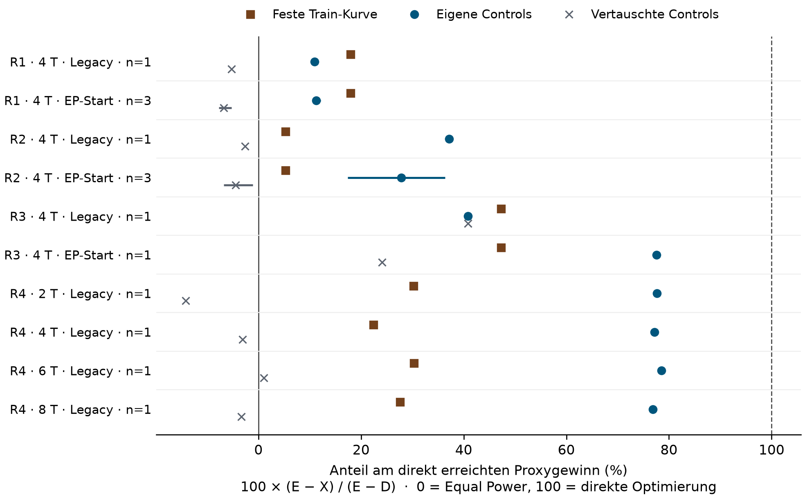

# F3 · Welchen Nutzen liefern eingabeabhängige Mixing-Controls?

Die Best-Checkpoints wurden auf derselben historischen Validation ausgewählt und verglichen. Für R1–R3 umfasst sie fünf gerichtete Paare aus zwei Aufnahmekomponenten. Der neue feste TCN wurde mit einem Seed und einem ausgeschöpften Budget von 30 Epochen trainiert. Auf diesen Daten gilt folgender Befund. Die zum Übergangsfenster passenden Controls senken den Validierungsproxy beim Vocal-MLP, beim festen TCN mit Equal-Power-Start und beim variablen September-TCN stärker als eine einzige auf Train optimierte Kurve. Beim kleinen Zwei-Band-MLP hilft die richtige Zuordnung gegenüber fremden Controls, während die feste Kurve den niedrigeren Gesamtverlust liefert. Der historische feste TCN bildet den Gegenfall. Er erzielt einen deutlichen Gewinn gegenüber Equal Power, obwohl seine ausgegebenen Controls über sämtliche Validierungsfenster gleich sind.

## Ergebnisse auf der historischen Validation

E, F, M und D sind die mittleren rohen Proxy-Losswerte bei Equal Power, fester Train-Kurve, Modell und direkter Optimierung je Cue. Kleinere Werte sind günstiger. S−M gibt an, um wie viel sich der Loss bei fremden Controls ändert. EP-v1 bezeichnet den neuen Initialisierungsvertrag. Bei drei Seeds steht in der Modellspalte Mittelwert ± Stichprobenstandardabweichung. Bei einem Seed lässt sich diese Streuung nicht schätzen. E/F/D werden innerhalb desselben Profil- und Längenvertrags für alle Checkpoints wiederverwendet.

| Pfad | Takte | Modellstart | Seeds | E | F | M | D (80 Updates) | S−M |
|---|---:|---|---:|---:|---:|---:|---:|---:|
| R1 · MLP | 4 | Legacy | 1 | 0,42103 | 0,41147 | 0,41521 | 0,36764 | +0,00862 |
| R1 · MLP | 4 | EP-v1 | 3 | 0,42103 | 0,41147 | 0,41502 ± 0,00039 | 0,36764 | +0,00963 |
| R2 · Vocal-MLP | 4 | Legacy | 1 | 0,35086 | 0,34719 | 0,32491 | 0,28104 | +0,02779 |
| R2 · Vocal-MLP | 4 | EP-v1 | 3 | 0,35086 | 0,34719 | 0,33142 ± 0,00673 | 0,28104 | +0,02257 |
| R3 · fester TCN | 4 | Legacy | 1 | 0,41052 | 0,30663 | 0,32078 | 0,19083 | 0,00000 |
| R3 · fester TCN | 4 | EP-v1 | 1 | 0,41052 | 0,30663 | 0,24004 | 0,19083 | +0,11763 |
| R4 · variabler TCN | 2 | Legacy | 1 | 0,22077 | 0,21051 | 0,19439 | 0,18679 | +0,03122 |
| R4 · variabler TCN | 4 | Legacy | 1 | 0,27305 | 0,26047 | 0,22970 | 0,21686 | +0,04508 |
| R4 · variabler TCN | 6 | Legacy | 1 | 0,27294 | 0,25712 | 0,23193 | 0,22074 | +0,04047 |
| R4 · variabler TCN | 8 | Legacy | 1 | 0,28776 | 0,27490 | 0,25190 | 0,24112 | +0,03740 |

Die Abbildung setzt das Equal Power des jeweiligen Pfads auf 0 und den nach 80 direkten Schritten erreichten Gewinn auf 100. Punkte bezeichnen Seedmittel, horizontale Linien bei drei Seeds die Spannweite. In allen ausgewerteten Paaren lagen E und E−D über der festgelegten Untergrenze. Die Rohwerte stehen in der [Ergebnismatrix](review_jp_20261118/p06_run02/matrix.csv), der [Paartabelle](review_jp_20261118/p06/pairs.csv) und der [Aufschlüsselung nach Losskomponente](review_jp_20261118/p06/components.csv).

## Was der Vergleich misst

Der Controller erhält die Merkmale zweier vorgegebener Übergangsfenster. Um zu prüfen, ob er sie sinnvoll nutzt, lässt sich dasselbe Fenster mit zwei Vorhersagen rendern. Einmal stammen die Controls aus seinen eigenen Merkmalen, einmal aus denen eines anderen Fensters. Audio, Stems, Zielverlauf und die Merkmale zur Berechnung des Loss bleiben beim Empfänger. Verschlechtert die Vertauschung den Loss, trägt die richtige Zuordnung zum gemessenen Proxygewinn bei. Eine zweite Frage ist, ob eine einzige auf Train optimierte Kurve für denselben Zweck ausreicht. Ein Modell kann empfindlich auf die Zuordnung reagieren und bei dieser zweiten Prüfung trotzdem hinter der festen Kurve liegen.

**Bedingungen.** E ist das nativ gerenderte Equal Power bei neutralem EQ und Ducking. F lernt eine einzige Kurvenschar aus allen zugelassenen Trainingspaaren, bei R4 eine je Länge. Jedes gerichtete Paar trägt gleich viel zum Gradienten bei, jeder Cue innerhalb seines Paars ebenfalls. M stammt aus dem nach der vorab festgelegten Regel gewählten Best-Checkpoint. D passt die Controls an den jeweiligen Validierungscue an. F und D beginnen bei E und verwenden Adam mit Lernrate 0,06. Ausgewertet wird der Stand nach 80 Updates. D liefert damit einen praktisch erreichten Vergleichswert. Die Nähe zum globalen Minimum bleibt unbekannt. [Protokoll](../EVALUATION_PROTOCOL.md) · [Native Renderer und Kontrollräume](REVIEW_JP_P04_RENDER_20261118.md)

Für die Vertauschung wird jedes gleich lange Validierungsfenster mit den Modell-Controls jedes anderen gerendert. Die Diagonale reproduziert M für denselben Cue. S bezeichnet den mittleren Loss der Fremdkurven je Empfänger, zunächst über alle fremden Cues und ergänzend getrennt nach gleichem und anderem Trackpaar. Eine weitere Vergleichskurve mittelt die vorhergesagten Controls der Trainingscues. Diese Mittelkurve und die direkt auf Train optimierte F-Kurve beantworten unterschiedliche Fragen.

Gemessen wird das Stereo-Brückensignal bei 11.025 Hz und Einheitsgain. R1 verwendet den Zwei-Band-Renderer und v4, R2 den Stem-Renderer und v5, R3 den Full-Band-Renderer und v4. Alle drei erhalten FP1-Merkmale auf Demucs-Basis. Die bei R2 tatsächlich gerenderten Stems stammen aus dem RoFormer-Cache. R4 verwendet FP2 und RoFormer für Merkmale und Stems sowie die zeitnormierte v5-Fassung. Die Filter haben 127 Koeffizienten, die Tieftongrenze liegt bei 180 Hz und die zusätzliche R3-Mittengrenze bei 3.500 Hz. Die Pegeldiagnose vergleicht jedes Signal X mit E desselben Fensters. Sie misst den RMS des Differenzsignals relativ zum RMS von E und die Beträge der Pegeldifferenzen in acht Zeitfenstern je Takt.

**Population und Unsicherheit.** R1 bis R3 verwenden D2 mit 37 gerichteten Trainingspaaren und fünf Validierungspaaren bei je zehn Cues. Die fünf Validierungspaare teilen sich fünf Aufnahmen. R4 nutzt D4 mit 221 Trainingspaaren bei zwei, vier und sechs Takten sowie 220 bei acht. Jede Länge umfasst 52 Validierungspaare aus 53 Audiohashes bzw. 52 technischen Recording-Gruppen. Der versiegelte Cache lässt bei zwei, vier und sechs Takten je 156 der 159 exportierten Fenster zu, bei acht Takten 154. Alle Bedingungen einer Länge verwenden dieselben zugelassenen Fenster. Die fünf D2-Validierungsgruppen und die 52 D4-Validierungsgruppen bei vier Takten sind disjunkt. Eine dieser D2-Gruppen kommt im D4-Training vor, sieben der D4-Validierungsgruppen im D2-Training. Ein Vergleich zwischen R3 und R4 vermischt damit Population, Features, Renderer und Objective.

Alle Hauptwerte mitteln zunächst Cues innerhalb eines gerichteten Trackpaars und anschließend die Paare mit gleichem Gewicht. Für Bedingung X ist der relative Gewinn `100 × (E−X)/E`, der Anteil am direkt erreichten Gewinn `100 × (E−X)/(E−D)`. In den Haupttabellen stehen E, X und D für Mittel derselben Paarmittel. Die Datentabellen enthalten zusätzlich jeden einzelnen Paarkontrast und das Mittel der definierten Paarquotienten. Ein Nenner ≤ 10⁻⁸ ergibt einen leeren Quotienten. Negative Werte und Anteile über 100 Prozent des direkt erreichten Gewinns bleiben erhalten. Die Seedstreuung ist die Stichprobenstandardabweichung über die drei vorab festgelegten Trainingsläufe. Für D2 zeigt die Matrix die beobachtete Spannweite der Paarkontraste. Bei R3 mit EP-v1 reicht S−M von 0,049533 bis 0,239297, beim Legacy-Modell sind alle fünf Differenzen null. Für R4 zieht der deskriptive Bootstrap ganze Aufnahmekomponenten. Jedes enthaltene Paar zählt pro Ziehung mit seiner Vielfachheit, der Spenderpool bleibt fest. Die früheren Einzelpaarintervalle in p06/matrix.csv waren nicht protokollkonform. Die Punktwerte gelten weiterhin.

**Initialisierung.** R1 startet auch unter Legacy hörsignalgleich mit E. R2-Legacy dämpft die Vocal-Stems bereits leicht. Beim festen R3 kombiniert der Legacy-Ausgang komplementäre lineare Hauptgains mit teilweise geschlossenen EQs und Ducking. Der P05-Vertrag interpoliert die Übergabeposition vor der Sinus-/Cosinusabbildung und startet mit offenen EQs und ohne Ducking. Der Vergleich bei Seed 20260926 hält Dataset samt Normalisierung, Audiofenster, Architekturgröße, Full-Band-Renderer, Objective v4, Optimierer, Batchgröße und Auswahlbudget konstant. Er misst den Wechsel des physischen Ausgangsvertrags einschließlich der Gainabbildung. Eine getrennte Wirkung der einzelnen Änderungen innerhalb dieses Vertrags lässt sich daraus nicht bestimmen. Bei R4 ist E0 die rekonstruierte untrainierte Ausgabe. Die September-History beginnt nach der ersten Trainingsepoche. [Startverträge und vorab benannte Seeds](REVIEW_JP_P05_INITIALISIERUNG_20261118.md)

**Welche Eingaben unterscheiden die Fenster?** In allen untersuchten Train-Shards sind 13 der 54 Sequenzkanäle bei gleicher Zeitposition praktisch konstant (mittlere Standardabweichung über die Fenster unter 10⁻⁷, A und B zusammen). Darunter fallen Positionsinformationen, die sich im Verlauf der Brücke ändern können. Von den 16 globalen Merkmalen sind auf D2 fünf konstant, auf D4 drei bei zwei Takten und fünf bei vier, sechs und acht Takten. Die mittlere Tonartkonfidenz in D2-Val beträgt 0,104 für A und 0,068 für B. Ob das Netz andere Merkmale erfolgreich nutzt, lässt sich aus diesen Kanalstatistiken allein nicht entscheiden.

F und D teilen bei R3 die Phasenparametrisierung mit dem echten Equal-Power-Start. Das Legacy-Modell übergibt seine historisch trainierten Gain-Stützstellen direkt an denselben Renderer. Der Abstand F−M unter Legacy enthält deshalb auch den Unterschied dieser Gainparametrisierungen.

## Wiederholungen auf D2

Für die Seeds 20260926, 20260927 und 20260928 wurde beim MLP v1 jeweils Epoche 1 gewählt. Alle drei Läufe stoppten nach Epoche 7. Ihr mittlerer Gewinn gegenüber dem R1-Equal-Power-Loss beträgt 1,43 % bei einer Seed-Standardabweichung von 0,09 Prozentpunkten. Die eigene Zuordnung spart gegenüber der Fremdkurve 0,009632 ± 0,000987 Loss-Einheiten. Die feste Train-Kurve liegt in allen drei Läufen vor dem Modell.

Beim Vocal-MLP v2 wurden in derselben Seedreihenfolge die Epochen 34, 10 und 35 gewählt. Die Läufe endeten nach 40, 16 und 41 Epochen. Alle drei Modelle unterbieten F auf der Validation, die auch der Checkpointwahl diente. Wie viel dieser Vorsprung auf die Auswahl zurückgeht, ist unbekannt. Der Gewinn gegenüber dem R2-Equal-Power-Loss beträgt im Mittel 5,54 % und streut über die Seeds um 1,92 Prozentpunkte. Die korrekte Zuordnung spart gegenüber der Fremdkurve 0,022572 ± 0,008775 Loss-Einheiten. Absolut weicht der lokale Pegelverlauf der eigenen Controls von E im Mittel um 0,40 dB ab, beim MLP v1 um 0,21 dB. Das sind Mittel der absoluten Frame-Differenzen bei Einheitsgain. Die Unterschiede zwischen Seeds betreffen dieselben fünf Validierungspaare.

## Was sich bei einer Vertauschung ändert

Beim September-MLP R1 wurde der Checkpoint nach einer Trainingsepoche gewählt. Sein M liegt auf den fünf Paaren bei 0,415208. Fremde Controls erhöhen den Loss im Mittel um 0,008617. Davon entfallen 0,008405 auf den gewichteten Term für die Vocal-Grenze. Der passende Übergabezeitpunkt hilft diesem Modell also bei einem konkreten Teilziel. Für den Gesamtproxy bleibt die feste Train-Kurve mit 0,411468 günstiger. Sie trifft das Energieziel besser. D senkt den Loss weiter auf 0,367636.

Beim historischen Vocal-MLP R2 steigt der Proxy von 0,324910 mit eigenen Controls auf 0,352702 mit fremden. Ein anderer Cue desselben Trackpaars ergibt im Mittel 0,337964, ein Cue eines anderen Paars 0,356018. Vom Anstieg bei allen Fremdkurven entfallen 0,018947 auf die gewichtete Vocal-Hörbarkeit und 0,009071 auf die Energieform. Der Begriff Hörbarkeit bezeichnet hier den Loss für die Dämpfung aktiver Stems. Eine tatsächliche Hörerbewertung wurde bei dieser Messung nicht erhoben.

Beim historischen festen TCN R3 haben alle zehn ausgegebenen Control-Kanäle an jeder Stützstelle über die 50 Validierungsfenster exakt dieselben Werte. Entsprechend liefert die Fremdkurve denselben Loss wie die eigene. Trotzdem sinkt der Loss von 0,410518 bei E auf 0,320779 bei M. Allein der gewichtete Energieterm sinkt um 0,101288, andere Terme gleichen einen Teil davon aus. Hier erklärt eine gelernte gemeinsame Kurvenform den Gewinn auf diesen Fenstern. Als Referenz für R3 muss der Full-Band-Pfad verwendet werden. Sein v4-Objective erhält den Zielgain als Mix-Control, der Zwei-Band-Pfad die Übergabeposition. Deshalb können sich schon die E-Proxys bei gleicher Samplebasis unterscheiden.

Der feste R3 mit EP-v1 wurde mit demselben Seed 20260926 und 1.013.226 trainierbaren Parametern trainiert. Der beste Checkpoint stammt aus Epoche 27, der Lauf erreichte die Obergrenze von 30 Epochen. Die nun eingabeabhängigen Controls senken den gepaarten CPU-Proxy auf 0,240038. Mit der festen Train-Kurve sind es 0,306628, mit fremden Modell-Controls 0,357669. Die Vertauschung kostet 0,117630, davon 0,105984 im gewichteten Energieterm. D erreicht 0,190831. Der in E27 gewählte Checkpoint nutzt bei einem Seed und dem Budget von 30 Epochen **77,60 % des direkt erreichten Gewinns E−D**. Der Legacy-Lauf endete durch Patience in E24 mit Best E18. Die mittlere absolute Pegeldifferenz gegenüber E beträgt 3,16 dB pro Zeitfenster. Dieser Kontrast spricht für den neuen Ausgangsvertrag auf D2, bei einem Trainingsseed und fünf gerichteten Paaren.

Bei R4 liegt M für jede der vier Längen näher an D als die feste Kurve. M erreicht je nach Länge 76,88 bis 78,56 % des jeweils von E bis D erreichten Proxygewinns, F erreicht 22,39 bis 30,30 % desselben Nenners. Die Zuordnung macht bei vier Takten einen Unterschied von 0,045078 Loss-Einheiten (S−M). Das deskriptive 95-%-Perzentilintervall über zwölf Aufnahmekomponenten (52 Paare, fester Spenderpool) reicht von 0,035708 bis 0,058904. Auch bei R4 diente dieselbe Validation der Checkpointwahl. Der Vergleich mit F schätzt den Vorteil auf neuen Aufnahmen nicht unabhängig. Vom Anstieg entfallen 0,032546 auf die Energieform und 0,012109 auf die gewichtete Vocal-Hörbarkeit. Die mittlere absolute Pegelabweichung von M gegenüber E beträgt über alle vier Längen jeweils zwischen 0,50 und 0,71 dB pro Zeitfenster. Diese Ergebnisse beschreiben einen September-Checkpoint auf vier Längen derselben Validierungspopulation.

## Reichweite des Reviewbefunds

Die oft zitierte Zahl von 99,9 Prozent stammt aus neun älteren Top-3-Validierungsfenstern. Ihr Nenner ist die Lossdifferenz **zwischen dem gedämpften frischen TCN und der dortigen direkten Optimierung**. Aus den gerundeten Rohwerten ergibt sich `(1,9629−0,2429)/(1,9629−0,2411)`. Schon das Öffnen der EQs kann viel von diesem ungewöhnlich hohen Startloss abbauen. Für den Septembervergleich verwendet der Nenner die Differenz zwischen einem echten Equal-Power-Render und D auf demselben Full-Band-Pfad. Wie gut eingabeabhängige Controls abschneiden, entscheidet sich hier am Abstand zu F und am Vertauschungstest. [Ursprüngliche Messreihe, Abschnitt 4.3](../../review_jp/CODE_REVIEW.md)

Am September-R3 lässt sich der Einfluss der Bezugsgröße beziffern. Die erreichte feste Kurve hat den Loss 0,306628, die direkte Optimierung 0,190831. Vom gedämpften Start bei 1,938311 aus gerechnet deckt F **93,37 %** der Differenz von diesem Start zu D. Vom echten Equal Power bei 0,410518 aus sind es **47,29 %** der Differenz E−D. F, D und die 50 ausgewerteten Cues sind in beiden Rechnungen identisch.

Die Frage nach hörbarem Nutzen bleibt offen. Im bestehenden geblendeten Fünfervergleich vergab ein Rater bei allen 19 gewerteten Cues denselben Rang für alle Methoden. Der neue R3-Checkpoint gehörte nicht zu diesem Hörsatz. Die hier gemessenen Verbesserungen belegen eine bessere Anpassung an Energie- und Vocal-Terme auf Entwicklungsdaten. Eine Präferenz der Hörenden lässt sich daraus nicht ableiten. [Hörbefund P5 und Exposition](../RESULTS_EVIDENCE_LEDGER.md)

## Nachrechnung

Die versionierbaren [Trainingshistorien](review_jp_20261118/p06/training.csv) dokumentieren jede Epoche und die Auswahl. Dazu kommen [Seedstreuung](review_jp_20261118/p06/seeds.csv), [Kanalstreuung der Controls](review_jp_20261118/p06/controls.csv), [Fremdzuordnungen und Rang der eigenen Kurve je Cue](review_jp_20261118/p06/swaps.csv) sowie [Runverträge, Quellenhashes und Abweichungen zur History](review_jp_20261118/p06/evidence.json). Die Diagnose misst die Audio- und Proxywerte für E/F/M/D auf CPU. Beim neuen R3 ergibt die Original-History am Best-Checkpoint auf CUDA 0,2400352, der CPU-Einzelforward 0,2400383. Bei R4 reproduzierte ein separater Validationlauf mit dem ursprünglichen CUDA-Runner und Batchgröße 4 sämtliche 18 Komponenten für jede Länge exakt.

Die lokalen Artefakte liegen unter `output/review_jp_20261118/p06_controller/run01/`. Die Unterordner `baseline/` und `response/` enthalten pro Profil und Länge die Rohzeilen mit Cue-IDs sowie das gehashte Protokoll. `swap.npz` speichert die vollständige Lossmatrix (Zeile = Empfänger, Spalte = Spender) mit Index und Initialisierungsvertrag. Die sieben benannten Trainingsordner enthalten History, Manifest und beide Checkpoints. Für eine erneute Ausführung bezeichnet `$r` einen freien Ergebnisordner. Alle Module werden aus dem Projektstamm mit `.venv\Scripts\python.exe -m` aufgerufen.

1. `src.evaluation.controller_preflight "$r/preflight"` prüft R1–R4. `src.evaluation.controller_repeats --output-root $r` führt die sieben [eingefrorenen Konfigurationen](review_jp_20261118/p05/p06_configs.json) aus. Start, Stopp und eventuelle Fehler bleiben im Testjournal.
2. `src.evaluation.controller_baselines R1 "$r/baseline/R1_4" --bars 4 --preflight "$r/preflight"` berechnet E/F/D. Den Aufruf für R2 und R3 bei vier Takten sowie für R4 bei zwei, vier, sechs und acht Takten ausführen. Ein Profil teilt seine F/D-Referenzen über alle Seeds. Die Batchbildung fasst ausschließlich identische Samplelängen und bei F identische Paargewichte zusammen.
3. `src.evaluation.controller_response R1 "$r/response/R1_4_legacy" --device cpu` untersucht den September-Checkpoint. Für weitere Legacy-Profile Profil, Länge und Ziel anpassen. Für die Wiederholungen beispielsweise `src.evaluation.controller_response R1 "$r/response/R1_equal_power_v1_seed20260926" --run "$r/R1_equal_power_v1_seed20260926" --device cpu` verwenden.
4. `src.evaluation.controller_history_replay "$r/history_replay"` wiederholt die R4-Validation unter CUDA in der ursprünglichen Batchgröße. `src.evaluation.controller_summary $r "$r/auswertung"` prüft die vollständigen Populationen, Cache- und Checkpointbindungen, E0 und History und erstellt die Paar- und Seedtabellen. Das [Testjournal](../Bemerkungen.md) enthält die Zwischenfehler und die Ergebnisse der Gegenproben.
