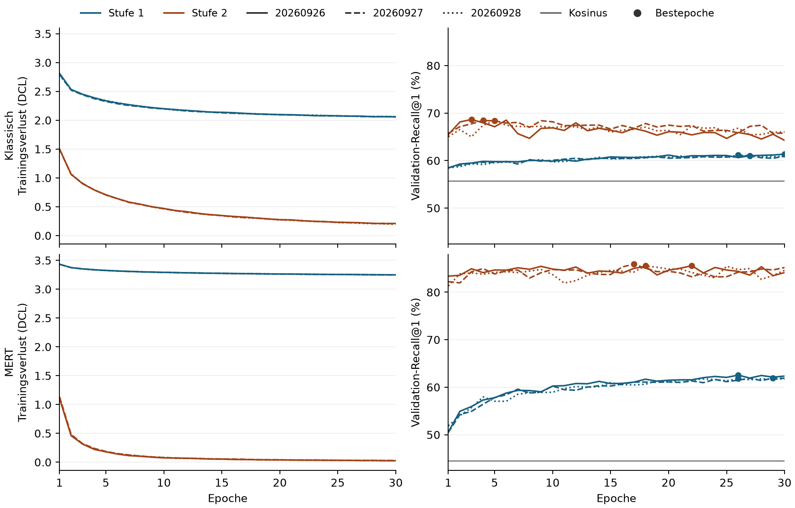

# P09 · Fortsetzungsmetrik über eine Lücke von vier Takten

## Ergebnisse auf der Validation

Der gerichtete MERT-Kopf erreicht im Mittel **85,67 % Recall@1**, der gerichtete klassische Kopf **68,49 %**. Bei den deterministischen Kosinusreferenzen liegt die klassische Repräsentation vorn. Die Tabelle zeigt Mittelwert und Stichprobenstandardabweichung der drei Seeds an ihren jeweiligen Bestepochen. Für die Kosinusreferenzen gibt es je einen Messwert. Alle Werte beziehen sich auf die richtige Selbstfortsetzung unter neun Kandidaten.

| Repräsentation | Stufe | Trainierbare Parameter | Bestepochen in Seedreihenfolge 26 / 27 / 28 | Recall@1 (%) | MRR |
|---|---:|---:|---|---:|---:|
| Klassisch | 0 | 0 | entfällt | 55,75 | 0,6800 |
| Klassisch | 1 | 10.496 | 30 / 27 / 26 | 61,17 ± 0,16 | 0,7284 ± 0,0017 |
| Klassisch | 2 | 108.288 | 3 / 4 / 5 | 68,49 ± 0,15 | 0,7928 ± 0,0007 |
| MERT | 0 | 0 | entfällt | 44,53 | 0,5710 |
| MERT | 1 | 98.304 | 26 / 29 / 26 | 62,09 ± 0,39 | 0,7468 ± 0,0016 |
| MERT | 2 | 459.533 | 22 / 17 / 18 | 85,67 ± 0,19 | 0,9151 ± 0,0013 |

Eine Epoche umfasst 406 volle Batches und einen Restbatch mit sieben Queries. Alle zwölf Trainings erreichten 12.210 AdamW-Updates. Bei den klassischen Türmen fiel der Trainingsverlust nach den frühen Bestepochen weiter. Für MERT lagen die drei ausgewählten Epochen später. In allen drei MERT-Checkpoints erhielt Zustand 11 (nullbasiert) das größte Mischgewicht, je nach Seed 16,67–19,45 % gegenüber anfänglich 7,69 %. Die größere Eingabebreite und die Schichtmischung ändern gemeinsam mit der Repräsentation die Kapazität. Ihr jeweiliger Anteil am Unterschied von 17,18 Prozentpunkten in Stufe 2 lässt sich aus diesem Vergleich nicht isolieren. [Gewichte, Kennzahlen und Hashes für alle 14 Bedingungen](P09_VERIFIED_20261119.json)



Stufe 2 übertrifft Stufe 1 für beide Familien in allen drei Seeds. Damit gibt es aus diesem Retrievalversuch keinen Anlass für den Reserve-Kreuzencoder. Die P08-MERT-Fenster enthalten bereits Kontext aus den Encoderchunks. Außerdem beeinflussen vier klassische Strukturmerkmale die Auswahl der harten Negativen für beide Familien. P10 prüft mit den eingefrorenen Same-Track- und Intro↔Drop-Kontrasten, wie viel Aufnahmeidentität zum Ergebnis beiträgt, und entscheidet anschließend über den Studienkopf. Die finale Population und Hörurteile kamen in P09 nicht zum Einsatz.

## Versuchsaufbau vom 19. November 2026

Die Eingabe jeder Rolle ist das arithmetische Mittel der vier Takte am jeweiligen Ende der P08-Lücke. Klassisch bleiben 82 Koordinaten aus dem auf 32.308 Trainingsoriginaltakten gefitteten P07-Scaler. MERT liefert pro Fenster 13 eingefrorene Zustände zu je 768 Koordinaten. Die Stufen 0 und 1 mitteln diese Zustände gleichgewichtet. Stufe 2 lernt 13 bei null initialisierte Logits für eine gemeinsame Softmax-Mischung beider Rollen. MERT erhält keine zusätzliche Standardisierung. [P07-Repräsentationen](REVIEW_JP_P07_REPRAESENTATIONEN_20261119.md)

| Stufe | Score und vor dem Smoke festgelegte Architektur | Klassisch | MERT |
|---|---|---:|---:|
| 0 | Kosinus der zwei Fenstermittel | 0 | 0 |
| 1 | Zwei lineare Faktoren ohne Bias, Rang höchstens 64 | 10.496 | 98.304 |
| 2 | Je Rolle ein eigener Turm mit 256 versteckten ReLU-Einheiten und 128 Ausgaben, Kosinus der Ausgaben | 108.288 | 459.533 |

In Stufe 1 sind x und y die auf Einheitslänge gebrachten Eingabevektoren. Der Score ist xᵀ Aᵀ B y. Jeder Faktor W wird durch die vierte Wurzel der maximalen absoluten Zeilensumme von (WWᵀ)² geteilt. Diese Größe begrenzt die Spektralnorm nach oben. So bleibt der Score innerhalb der für die P08-Verlustkorrektur benötigten Grenzen [−1, 1], und der Zähler ist in beiden normalisierten Eingaben bilinear. Die Faktoren enthalten zusammen 2 × 64 × Eingabebreite freie Parameter. In Stufe 2 ist die Zahl je Turm (Eingabebreite + 1) × 256 + (256 + 1) × 128. Bei MERT kommen die 13 Mischlogits hinzu. [Implementierung](../../src/ml/p09_metric.py)

Je trainiertem Kopf gelten die 30 vollständigen Epochen, Batchgröße 32 einschließlich Restbatch und die drei Seeds 20260926 bis 20260928 aus dem eingefrorenen Protokoll. AdamW verwendet die konstante Lernrate 0,001 und Weight Decay 0,0001. P08 bestimmt je Seed und Epoche die Queryreihenfolge und die Quell- und Zielproduktion. Vier explizite Negative und die gültigen fremden Batchziele gehen in die Chuang-Korrektur ein (Temperatur 0,2, positiver Prior 0,05). Das Training verwendet allein die Zeitfolge der Aufnahme als Positivsignal. [P08-Paare und Verlust](REVIEW_JP_P08_PAARE_20261119.md)

Für jede der 2.830 Validationsqueries werden eine echte Fortsetzung und acht feste Alternativen gerankt. Gleichstände löst die versiegelte Panelreihenfolge auf. Recall@1 und MRR werden erst je Quellaufnahme und dann gleichgewichtet über alle 54 Quellaufnahmen aus 53 Gruppen gemittelt. Alle 53 Gruppen dienen mehrfach als fremde Negativspender. Die früheste Epoche mit maximalem Recall@1 liefert den Checkpoint. Der wieder geladene Checkpoint muss beide Kennzahlen reproduzieren. Stufe 0 liefert je Familie genau eine deterministische Zeile. [Eingefrorenes Protokoll](../EVALUATION_PROTOCOL.md)

## Reproduktion und Übergabe an P10

Aus dem Repositoryroot laufen Smoke und Haupttraining in getrennte, jeweils neue Ausgabeverzeichnisse. Der Runner prüft die SHA der P08-Freigabe, der Splitdateien und der geladenen P07-Arrays. Für den Smoke verwendet er 35 reale Trainingsqueries in zwei Batches und 24 Validationsqueries. Die vorberechneten Vier-Takt-Mittel und die Masken werden direkt mit dem P08-Loader verglichen. Jeder trainierbare Parameterblock muss sich ändern.

```powershell
.venv\Scripts\python.exe -B -X utf8 -u -m src.ml.p09_train --smoke --output output/review_jp_20261118/p09_metrik/replay_smoke
.venv\Scripts\python.exe -B -X utf8 -u -m src.ml.p09_train --output output/review_jp_20261118/p09_metrik/replay
.venv\Scripts\python.exe -B -X utf8 -m src.evaluation.p09_verify --run output/review_jp_20261118/p09_metrik/replay --receipt output/review_jp_20261118/p09_metrik/replay/audit.json
```

Der Hauptlauf speichert für jede Bedingung die 2.830 Einzelränge mit Query-ID. Jedes Training schreibt außerdem den Train-DCL, Recall@1, MRR, kumulierte Updates und den Hash der Queryreihenfolge je Epoche nach `history.json`. Die Pfade zu den ausgewählten Gewichten und deren SHA-256 stehen in der [Einzeltabelle](../../output/review_jp_20261118/p09_metrik/run01/matrix.csv). Ein Checkpoint bindet die Konfiguration über deren SHA und enthält Familie, Stufe, Seed, Epoche sowie den vollständigen Zustandsvektor des Kopfes. Die `scaler_id` gilt für klassische Eingaben. P10 kann die gleiche Schnittstelle für das versiegelte Panel und neue Entwicklungskandidaten verwenden.

```python
state = torch.load(checkpoint_path, map_location="cpu", weights_only=True)
model = ContinuationMetric(state["family"], state["level"])
model.load_state_dict(state["state_dict"])
model.eval()
with torch.no_grad():
    # query_bars: [B, 4, ...], candidate_bars: [B, N, 4, ...]
    scores = model(query_bars.mean(1), candidate_bars.mean(2))
```
