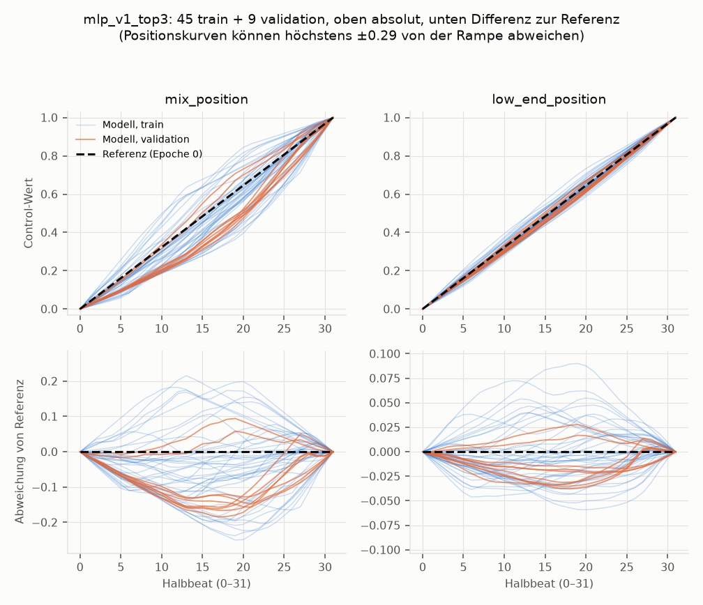
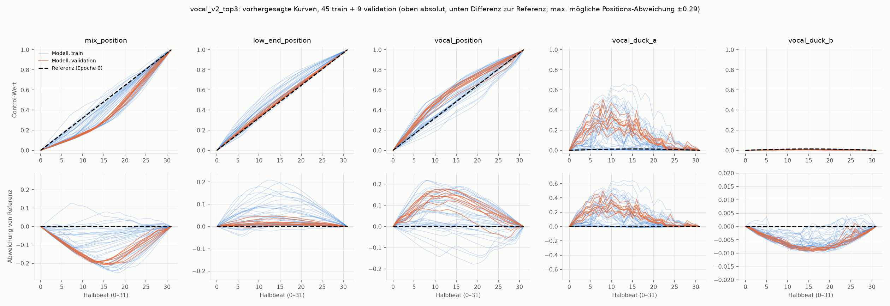
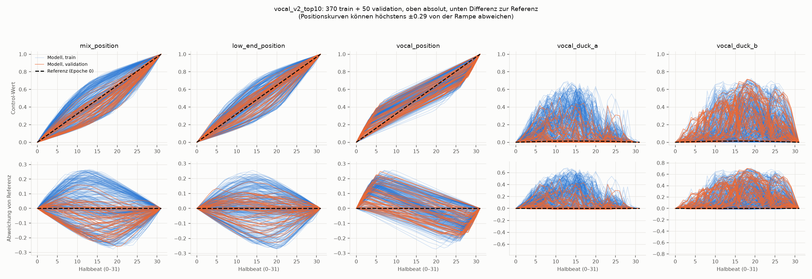
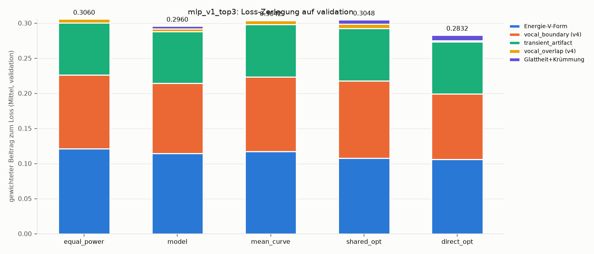
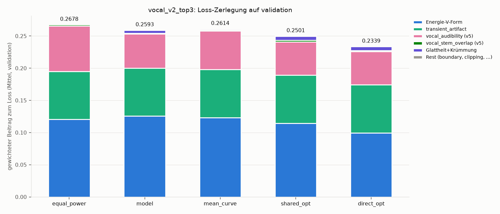
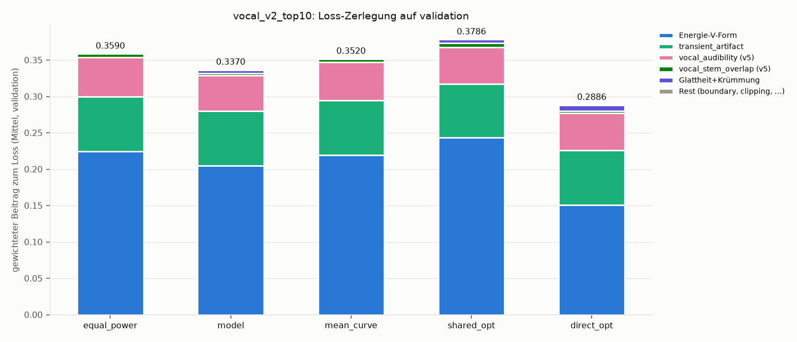
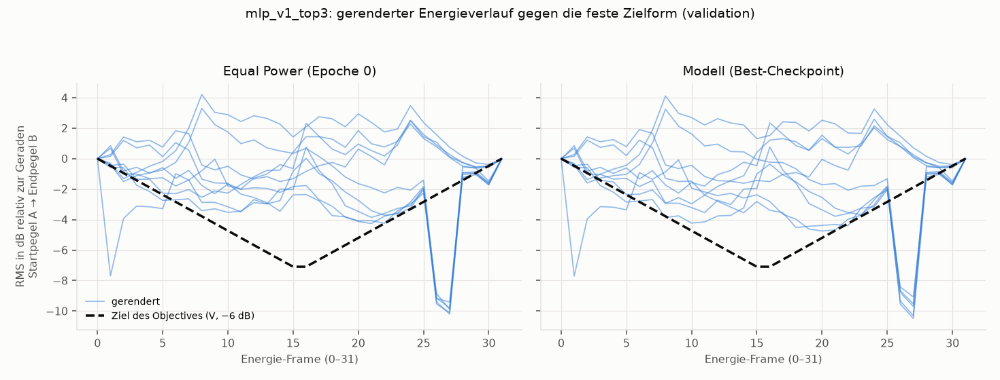
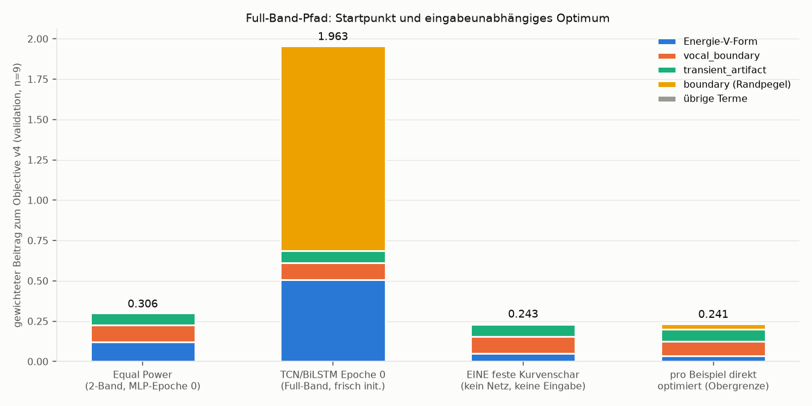

# BeatBridge: unabhängiges Code-Review

Stand: 13. November 2026, Commit `56b982a` (während des Reviews per Pull von `7918338` aktualisiert; der gesamte ML-Kern ist zwischen beiden Commits unverändert, geändert wurden nur `src/candidates/`, `src/gui/`, zwei Dateien in `src/evaluation/` und ein Test). Rechner: macOS, Python 3.14, CPU.

**Herkunft jeder Aussage** steht als Marke dahinter:

| Marke | Bedeutung |
|---|---|
| **[C]** | von mir selbst im Code gelesen |
| **[C*]** | von einem Hilfsagenten gelesen, die Fundstelle habe ich selbst nachgelesen |
| **[A]** | von einem Hilfsagenten gelesen, von mir nicht nachgeprüft |
| **[M]** | von mir ausgeführt und gemessen (Skripte und Rohdaten unter `review_jp/`) |
| **[D]** | nur laut Doku, nicht geprüft |

Die Randbereiche (Analyse, Kandidaten, Ranking, Cue-Ranker, GUI, Testklassifikation) haben vier Hilfsagenten gelesen. Objective, Renderer, Modelle, Training, Features und Datensatz-Export habe ich vollständig selbst gelesen.

---

## 1. Kurzfazit

Der Code analysiert Songs auf ein Beat-/Taktraster, erzeugt alle Downbeat-Paare als Übergangskandidaten, wählt daraus mit einer handgewichteten Regelformel aus und überblendet zwei Songs über 2 oder 4 Takte. Darauf sitzt ein kleines Netz, das aus 54 handgebauten Merkmalen pro Halbbeat Überblendkurven vorhersagt und gegen eine handgebaute Verlustfunktion trainiert wird.

Was er nicht tut: Er lernt und nutzt keine selbstüberwachten Audio-Repräsentationen, die Metrik für die Passung zweier Abschnitte ist eine ungeeichte Regelformel, es gibt keine 1- und 3-Takt-Übergänge im ML-Pfad und keinen Export eines Mashups aus mehr als zwei Songs.

Die drei wichtigsten Befunde:

1. **Das Trainingsziel belohnt eine feste Form, die der Standard-Renderer gar nicht erzeugen kann.** Der Energie-Term verlangt bei jedem Übergang eine V-förmige Senke von 6 dB. Im Zwei-Band-Renderer bleiben davon auch nach direkter Optimierung 88 % stehen, im Vocal-Renderer 67 bis 83 %. Im Full-Band-Pfad (TCN/BiLSTM) ist die Senke erreichbar, und dort holt eine einzige feste Kurvenschar ohne Netz und ohne Eingabe 99,9 % des möglichen Gewinns.
2. **Die gelernten Kurven ändern das Audio kaum.** Die lokalen Netze reagieren messbar auf ihre Eingabe, senken den Verlust aber nur um 3 bis 6 % und verändern den Pegelverlauf im Median um höchstens 0,7 bis 1,4 dB. Dazu passt der Hörtest vom 6. November laut Doku: 19 von 19 Beispielen Gleichstand zwischen allen Modellen und Equal Power.
3. **Der Startpunkt des TCN/BiLSTM ist nicht Equal Power, obwohl das Protokoll es so nennt.** Er liegt 9,9 dB unter Equal Power, weil EQ und Ducking mit 0,5 starten. Der dokumentierte Verlustrückgang von 1,94 auf 0,32 ist deshalb überwiegend das Zurücklernen der normalen Lautstärke.

---

## 2. Die vier Verdachtspunkte

### Verdacht 1: Der Energie-Term belohnt eine feste Zielform und dominiert den Loss

**Teilweise bestätigt; für den Full-Band-Pfad voll bestätigt.**

- Feste Form: bestätigt. Das Ziel hängt nur über zwei Zahlen von der Musik ab, den Pegel des ersten Frames von A und des letzten Frames von B. Dazwischen liegt immer ein V mit Tiefpunkt `min(Start, Ende) − 6 dB` in der Mitte (`src/control/differentiable.py:620-625`, `:1190-1208`) **[C]**.
- Dominanz im Zwei-Band-Pfad: Der Term ist der größte Einzelposten (40 bis 62 % des Verlusts bei Equal Power) und trägt in zwei von drei lokalen Läufen den Großteil des Gewinns (69 % und 89 %). Im dritten Lauf wird er sogar schlechter **[M]** (Abschnitt 4.2).
- Der Term ist dort größtenteils unerreichbar: Ein Render mit perfekt geradem Pegelverlauf bekäme 0,122. Equal Power bekommt 0,121, die direkte Optimierung des Gesamtverlusts pro Beispiel senkt ihn nur auf 0,106 **[M]**. Je nach Lauf bleiben 67 bis 88 % des Terms stehen.
- Full-Band-Pfad: Eine einzige feste Kurvenschar (10 Kurven, kein Netz, keine Eingabe) erreicht auf Validation 0,2429, die direkte Optimierung pro Beispiel 0,2411. Der Energie-Term fällt dabei von 0,507 auf 0,050 **[M]** (Abschnitt 4.3).

### Verdacht 2: Das einfache MLP hat kaum gelernt und gibt für alle Eingaben fast dieselbe Kurve aus

**In dieser Form widerlegt für die drei lokalen Checkpoints; für den genannten Lauf (0,4210 → 0,4152) offen.**

- Der Lauf mit 0,4210 → 0,4152 (bester Checkpoint nach Epoche 1) ist der September-Lauf R1 auf dem größeren Datensatz **[D]** (`docs/RESULTS_EVIDENCE_LEDGER.md`, Zeile R1). Er liegt nicht lokal vor. Der lokale MLP-Lauf vom August ist ein anderer: bester Checkpoint nach Epoche 8, Validation 0,30596 → 0,29600 **[M]**.
- Die lokalen Netze geben nicht dieselbe Kurve aus: Die Streuung der Mix-Kurve über Beispiele liegt bei 5 bis 9 % des Wertebereichs (maximal 14 %), einzelne Kurven nutzen bis zu 0,28 der maximal möglichen 0,29 Abweichung von der Rampe **[M]** (Abschnitt 4.1).
- Trotzdem ist der Nutzen klein: 3,2 bis 6,1 % weniger Verlust. Beim Vocal-Modell auf dem kleinen Datensatz bleiben 73 % des Gewinns erhalten, wenn man die Kurven eines falschen Beispiels anwendet **[M]**.
- Für R1 gilt: 1,4 % Verlustrückgang ist weniger als die Hälfte des lokalen Laufs. Ob dort die Kurven noch von Equal Power abweichen, beantwortet `review_jp/scripts/b1_b2_model_response_and_loss.py` auf dem Rechner des Studenten (Abschnitt 8).

### Verdacht 3: Ein Teil der 54 Features ist konstant oder null

**Bestätigt.**

- 13 von 54 Kanälen haben an jeder Zeitposition für alle Beispiele exakt denselben Wert und tragen keine Information über die Musik **[M]**. Fünf davon sind exakt null (vier Phrasen-Kanäle und `phrase_valid`), weil sie nie beschrieben werden (`src/features/extract_track.py:394`, `:333` „not_implemented") **[C]**.
- Zwei weitere sind praktisch tot (`silence_probability`) oder schwach (`kick_prominence`) **[M]**.
- Von den 16 globalen Kanälen sind 2 immer konstant, im größeren Datensatz 5 **[M]** (Abschnitt 4.4).

### Verdacht 4: Viele Tests sichern Formate und Provenienz, wenige die fachliche Korrektheit

**In der Größenordnung bestätigt.**

- 256 Testfunktionen in 55 Dateien: rund 25 % fachlich, 71 % Vertrag/Format/Hash/Provenienz, 4 % Smoke **[A]** (Abschnitt 4.6).
- Nur 11 Tests prüfen ein Ergebnis auf Audioebene, alle auf synthetischen Signalen **[A]**.
- Renderer und Objective sind auf Unit-Ebene ordentlich abgedeckt. Es fehlen die Äquivalenz der beiden Renderer, die Eingabeabhängigkeit trainierter Modelle, die Validität des Objectives und jede Beat-Erkennung auf einem Signal mit bekannter Wahrheit **[A]**.

---

## 3. Datenfluss Schritt für Schritt

### 3.1 Analyse (`src/analysis/pre_analysis.py`)

- Beats kommen von `librosa.beat.beat_track` auf dem Mono-Signal in nativer Sample-Rate, mit Median-aggregierter Onset-Hüllkurve und sonst librosa-Defaults (`:450-456`) **[C*]**. Das BPM ist der globale librosa-Schätzwert; es gibt keinen BPM-Bereich und keine Behandlung von Halb-/Doppeltempo **[A]**.
- Die Taktposition (Zählzeit, Taktart) kommt ausschließlich vom Windows-Programm `aufTAKTCl.exe`, das per Subprozess aufgerufen wird (`:35`, `:144-149`, `:475-486`) **[C*]**. Jedem librosa-Beat wird der nächste aufTAKT-Beat innerhalb von 0,2 s zugeordnet (`:18`) **[C*]**. Die neuere Variante verlangt 98 % Abdeckung und mindestens 8 zusammenhängende Takte (`:33-34`, `:858-865`) **[C*]**.
- Fallback: Schlägt aufTAKT fehl, wird nur gewarnt und ein 4/4-Raster gebaut, bei dem der erste erkannte Beat als Zählzeit 1 gilt (`:560-565`, `:74-106`) **[C*]**. Das Ergebnis ist als `fallback_used=True`, `confidence=0.0` markiert (`:101-106`) **[C*]**. Auf macOS ist das der Normalfall, weil die `.exe` gefunden, aber nicht gestartet werden kann **[A]**.
- Es gibt keine Strukturerkennung: keine Segmentgrenzen, kein Drop, Build-up oder Break **[A]**.

### 3.2 Kandidaten (`src/candidates/generation.py`, `variable.py`)

- Cue-Punkt ist jeder Downbeat (`generation.py:322`) **[C*]**. Der Übergang überlagert A ab dem Cue mit B vor dem Cue (`generation.py:92-97`) **[C*]**. Erzeugt wird das volle Kreuzprodukt aus Quell-Downbeats, Ziel-Downbeats und Längen **[A]**.
- Filter: Raster muss verifiziert sein (Default `approximate_grid_policy="reject"`, `:30`, `:147-153`), Tempodifferenz höchstens 15 % (`:29`, `:163-164`) **[C*]**. Es gibt keinen Energie- oder Stillefilter **[A]**.
- Längen: Die ältere Erzeugung hat den Default `(2, 4)` (`generation.py:26`) **[C*]** und lässt laut Hilfsagent jede positive Länge zu **[A]**. Die variable Erzeugung erlaubt nur `(2, 4, 6, 8)` (`variable.py:31`, `:52`) und rechnet hart mit 4/4 (`variable.py:319`) **[C*]**.
- Neu seit `56b982a`: Die Erzeugung nimmt einen Suchbereich in Samples für Quelle und Ziel an (`generation.py:185-186`, `:297-301`) **[C]**.
- 1 und 3 Takte sind in dieser Schicht eine kleine Änderung. Der Aufwand steckt im ML-Pfad (Abschnitt 5).

### 3.3 Ranking (`src/ranking/`)

- `feature_baseline_v3`: `0,30·high_power + 0,30·non_overlap + 0,18·harmonic + 0,10·energy + 0,05·timbre + 0,07·tempo` (`feature_baseline.py:21-26`, `:346-353`) **[C*]**.
- `high_power` und `non_overlap` sind Pegel-Perzentile relativ zum ganzen Track (`:286-319`, `:447-465`) **[C*]**. `harmonic` ist der Kosinus zweier zeitgemittelter Chroma-Vektoren aus `librosa.feature.chroma_stft` (`:404-405`, `:324-328`) **[C*]**. Es gibt keine Tonart-Schätzung und keinen Rhythmus-Term **[C*]**.
- `rendered_transition_baseline_v1`: `0,30·energy_shape + 0,30·boundary + 0,20·harmonic + 0,20·rhythmic` (`rendered_transition.py:18-21`) **[C*]**. `energy_shape` belohnt dieselbe 6-dB-Senke wie das Objective (`:22`, `:224-232`) **[C*]**. Die Metrik dient nur dem Reporting und als Wächter beim Cue-Ranker-Lehrer **[A]**.
- `song_compatibility`: `0,35·harmonic + 0,25·tempo + 0,15·timbre + 0,15·energy + 0,10·rhythm` über den ganzen Track (`song_compatibility.py:23-27`) **[C*]**. Der „Rhythmus" ist ein auf 32 Punkte interpoliertes Profil der Onset-Hüllkurve des ganzen Songs, ohne Beat-Bezug (`:274-281`) **[C*]**.
- Kein Gewicht wurde an Daten oder Bewertungen geeicht. Die Suche nach Fit- oder Kalibrierungscode ergab nichts **[A]**.

### 3.4 Features (`src/features/`)

Alle 54 Kanäle pro Halbbeat und 16 globale Kanäle, definiert in `contract.py:42-311` und `:314-387` **[C]**, berechnet in `extract_track.py:391-549` und `global_pair.py:47-91` **[C]**. Die Spalte „Befund" kombiniert Code und Messung (Abschnitt 4.4).

| Nr. | Kanal | Berechnung | Befund |
|---|---|---|---|
| 0 | `transition_position` | Rampe, in `model_window` gesetzt (`extract_track.py:127-129`) | für alle Beispiele identisch |
| 1–2 | `beat_phase_sin/cos` | Phasen 0,25 und 0,75 (`:622`) | identisch; `cos` konstant 0 |
| 3–4 | `bar_phase_sin/cos` | aus Zählzeit (`:624-626`) | identisch, weil alle Cues auf Downbeats liegen |
| 5–8 | Phrasen-Kanäle | nie beschrieben | exakt null |
| 9–11 | `rms_dbfs`, `rms_db_relative`, `loudness_slope` | RMS pro Halbbeat (`:505-518`) | berechnet, variieren |
| 12–14 | Bandanteile tief/mittel/hoch | FFT pro Halbbeat (`:431-439`) | berechnet, variieren |
| 15 | `local_energy_percentile` | Rang im Track (`:519-522`) | berechnet |
| 16 | `crest_factor` | Spitze/RMS (`:466-471`) | berechnet |
| 17 | `silence_probability` | `clip((−dB − 45)/15)` (`:523-527`) | praktisch tot (99,9 % Nullen) |
| 18–21 | Centroid, Bandbreite, Rolloff, Flatness | FFT (`:441-464`) | berechnet |
| 22–23 | `spectral_flux`, `onset_strength` | Differenz eines 128-Bin-Deskriptors (`:500-503`), p99 der Trainingstracks (`:371-388`) | berechnet |
| 24 | `kick_prominence` | `tief · (1 − exp(−20·onset))` (`:528-532`) | schwach: Mittel 0,012, weil `onset` um 0,004 liegt |
| 25 | `beat_pulse_confidence` | konstant 1,0 (`:408`) | Platzhalter |
| 26–37 | `chroma_00..11` | FFT-Bins ab 27,5 Hz auf Tonklassen (`:478-485`) | berechnet, fachlich fragwürdig (Abschnitt 6, Nr. 9) |
| 38–43 | `tonnetz_0..5` | `librosa.feature.tonnetz` auf dieser Chroma (`:535`) | berechnet, erbt das Chroma-Problem |
| 44 | `harmonic_ratio` | Leistungsanteil lokaler Spektralmaxima (`:487-498`) | berechnet; keine Harmonisch/Perkussiv-Trennung |
| 45–50 | sechs Vocal-Kanäle | aus RMS des Vocal-Stems (`:552-589`) | berechnet, wenn ein Stem vorliegt |
| 51 | `audio_valid` | konstant 1,0 (`:407`) | Platzhalter |
| 52 | `phrase_valid` | nie beschrieben | exakt null |
| 53 | `vocal_valid` | 1,0 bei vorhandenem Stem (`:589`) | in beiden Datensätzen konstant 1 |

| Nr. | Globaler Kanal | Befund |
|---|---|---|
| 0–1 | `bpm_a`, `bpm_b` | berechnet, sehr geringe Streuung (enger BPM-Bereich) |
| 2–4 | Tempoverhältnis, Tempoänderung, Anpassung nötig | im größeren Datensatz exakt null für alle Beispiele |
| 5–12 | Tonart A und B (Tonika sin/cos, Modus, Konfidenz) | berechnet aus den 32 Chroma-Bins des Fensters (`global_pair.py:94-117`); mittlere Konfidenz 0,08 bis 0,17 |
| 13 | `harmonic_compatibility` | Kosinus der mittleren Chroma (`global_pair.py:120-127`), Mittel 0,79 bis 0,84 |
| 14–15 | `context_coverage_a/b` | konstant 1,0 |

Die Vocal-Stems kommen von BS-RoFormer oder Demucs, beides überwacht trainierte Quellentrennung (`src/features/vocal.py:22-25`) **[C]**. Im gesamten `src/` gibt es keinen Aufruf eines selbstüberwachten Audio-Modells (Suche nach MERT, wav2vec, HuBERT, CLAP, MusicFM: kein Treffer) **[M]**.

### 3.5 Modelle (`src/ml/model.py`, `variable_model.py`)

- `time_shared_mlp_v1`: LayerNorm über den 124-dimensionalen Vektor (2·54 + 16), zwei Schichten mit 64 und 32 Einheiten, zwei Ausgaben pro Intervall (`model.py:230-242`) **[C]**. Dasselbe MLP wird auf jedes der 31 Intervalle einzeln angewendet, ohne zeitlichen Kontext (`:255-259`) **[C]**. 10 394 Parameter **[M]**.
- `vocal_time_shared_mlp_v2`: zwei solche MLPs, drei Positionskurven plus zwei Ducking-Kurven (`:402-484`) **[C]**. 20 821 Parameter **[M]**.
- `tcn_bilstm_transition_control_v1`: geteilter Conv-Encoder 54→64→128→128, Fusion `[A, B, A−B, A·B]`, zweilagiges BiLSTM, zehn Ausgaben pro Halbbeat (`:281-395`) **[C]**. 1 013 226 Parameter **[M]**, bei 45 bis 370 Trainingsbeispielen.
- Ausgabeparametrisierung der Positionskurven: `0,6·tanh(logit)` → Softmax über 31 Inkremente → kumulierte Summe (`differentiable.py:1147-1155`) **[C]**. Die Kurven sind damit konstruktiv monoton mit Endpunkten 0 und 1.
- Einschränkung des Lösungsraums: Das größte Inkrement ist 0,0996 statt 0,0323 bei Gleichverteilung, das Verhältnis größtes zu kleinstes Inkrement höchstens 3,32 (`differentiable.py:1130-1144`) **[C]**. Die Kurve kann höchstens 0,291 von der linearen Rampe abweichen, der Übergabepunkt (Position 0,5) liegt frühestens bei 26 % und spätestens bei 74 % des Fensters. An der Stelle der größten Positionsabweichung entspricht das rund 4 dB Gain-Unterschied zu Equal Power **[M]** (nachgerechnet). Ein harter Schnitt, ein spätes Einblenden oder ein Pegeltal sind im Zwei-Band-Renderer ausgeschlossen.
- Variable Modelle: Längen `(2, 4, 6, 8)` Takte (`src/features/variable_contract.py:25`) **[C]**. Der variable TCN berechnet sechs EQ-Ausgaben, die nie gerendert werden, weil das Training nur Positionen und Ducking an den Renderer gibt (`variable_model.py:404-408`, `src/ml/variable_training.py:78-88`) **[C]**.

### 3.6 Renderer und Objective (`src/control/differentiable.py`, vollständig gelesen)

**Renderer.** Zwei-Band: Tiefpass bei 180 Hz, Rest als Hochband, beide Bänder mit eigenem cos/sin-Paar überblendet (`:213-228`) **[C]**. Vocal-Renderer: Begleitung wie Zwei-Band, Vocal-Stems mit eigener Position und Ducking bis 75 % (`:521-565`) **[C]**. Full-Band: drei Bänder (180 Hz, 3,5 kHz), lineare Gains `gain_a`, `gain_b`, sechs EQ-Faktoren in [0, 1], Ducking (`:386-429`) **[C]**.

**Objective v4** (`:599-691`), mit `r`, `s`, `t` als RMS in dB über 32 Frames für Render, Quelle, Ziel, `m` und `l` als Mix- und Low-End-Kurve, `Δ` als Inkrement, `u = 1/31` **[C]**:

| Term | Formel | Gewicht | hängt ab von |
|---|---|---|---|
| `energy_shape` | `mean(((r − V)/12)²)`, `V` = V-Form von `s[0]` über `min(s[0], t[31]) − 6` nach `t[31]` | 1,0 | Audio, Controls |
| `boundary` | `mean(((r[0] − s[0])/6)², ((r[31] − t[31])/6)²)` | 0,5 | Audio; durch feste Endpunkte praktisch 0 |
| `control_smoothness` | `mean(((Δm − u)/u)² + ((Δl − u)/u)²)` | 0,02 | nur Controls |
| `control_curvature` | `mean((Δ²m/u)² + (Δ²l/u)²)` | 0,05 | nur Controls |
| `monotonicity` | `mean(relu(−Δm)² + relu(−Δl)²)` | 0,1 | nur Controls; konstruktiv 0 |
| `clipping` | `mean(relu(abs(Audio) − 1)²)` | 2,0 | Audio |
| `vocal_overlap` | `mean(v_a · v_b · (cos·sin)²)`, `v` = Aktivität·Prominenz·Konfidenzgewicht | 1,0 | Features, Controls; nicht vom Audio |
| `vocal_boundary` | `mean((Δm/u) · ½ · (Kosten_A + Kosten_B))` | 0,3 | Features, Controls; nicht vom Audio |
| `transient_artifact` | `mean(max(flux, onset) · (Δm/u + ½·Δl/u))` | 0,08 | Features, Controls; nicht vom Audio |

**Objective v5** (`:694-802`) setzt `vocal_overlap` und `vocal_boundary` auf Gewicht 0 (`:124-125`) und ergänzt **[C]**:

| Term | Formel | Gewicht |
|---|---|---|
| `vocal_stem_overlap` | `mean(σ_a · σ_b · (g_a · g_b)²)`, `σ` = Feature-Stärke · normierte Stem-RMS | 1,0 |
| `vocal_audibility` | `mean(σ_a(1 − 0,75σ_b)(1 − g_a)² + σ_b(1 − 0,75σ_a)(1 − g_b)²)` | 0,5 |
| `vocal_mid_phrase_gain_change` | `mean(σ·(1 − Onset/Offset) · Δg²)` | 0,2 |

Antworten auf die gestellten Fragen:

- Das Energieziel ist eine feste Form. Die Musik geht nur über Start- und Endpegel ein (`:620-625`, `:1205-1208`) **[C]**.
- Nur von den Controls hängen ab: `control_smoothness`, `control_curvature`, `monotonicity` **[C]**.
- Nicht vom Audio, nur von Features und Controls hängen ab: alle drei v4-Konditionsterme (`:1211-1295`). `vocal_overlap` rechnet mit cos/sin der Mix-Kurve, nicht mit den tatsächlich gerenderten Gains (`:1246-1249`) **[C]**.
- `vocal_boundary` und `transient_artifact` sind linear im Inkrement (`:1259-1266`, `:1284-1287`). Weil die Inkremente sich zu 1 summieren, liegt ihr Minimum immer am Rand der zulässigen Menge. Die Lösung bestimmt also die Schranke 0,6, nicht der Term **[C]**.
- Es gibt keinen harmonischen und keinen rhythmischen Term. Chroma, Tonnetz, Tonart und Beat-Phase werden im Objective nicht gelesen; die Liste der gelesenen Kanäle steht in `:1316-1330` **[C]**.

### 3.7 Training (`src/ml/training.py`, `runner.py`, `vocal_runner.py`, `variable_runner.py`, `data.py`)

- Audio: Übergangsfenster bei 44,1 kHz extrahiert, auf 11 025 Hz heruntergerechnet, Stereo (`data.py:42`, `:121-135`, `:577`) **[C]**. Features gehen unnormiert ins Netz und ins Objective (`data.py:432-434`) **[C]**.
- Batch 5, AdamW, Lernrate 1e-3, Weight Decay 1e-4, Gradient-Clipping 1,0, höchstens 30 Epochen, Patience 6, `min_delta` 1e-4 (`runner.py:68-79`) **[C]**. Jedes Beispiel wird in einer Python-Schleife einzeln gerendert (`training.py:40-63`) **[C]**.
- Checkpoint-Auswahl: niedrigster Validation-Verlust mit `min_delta` (`runner.py:510-516`, `:541-542`) **[C]**. Ein Test-Split wird im Runner nicht geladen (`:164-177`) **[C]**.
- Seeds: ein fester Seed pro Lauf (`runner.py:321`, `:884-890`), Mischreihenfolge aus Seed plus Epoche (`:659-660`) **[C]**. Kein Lauf wurde mit mehreren Seeds wiederholt **[D]**.
- Initialisierung: Die Ausgabeschicht ist mit Nullen initialisiert (`model.py:238-240`), Epoche 0 wird vor dem ersten Schritt ausgewertet (`runner.py:401-427`) **[C]**.
- **Ist Epoche 0 wirklich Equal Power?**
  - MLP v1: ja. Der Zwei-Band-Renderer mit linearer Rampe weicht vom nicht-differenzierbaren `EqualPowerFadeCut` um höchstens 2,4·10⁻⁷ ab (−140 dB) **[M]** (`review_jp/results/b5_renderer_equivalence.json`).
  - Vocal-MLP v2: fast. Ducking startet bei `0,75·sigmoid(−4)` = 1,3 % (`model.py:86`, `:455-460`) **[C]**.
  - TCN/BiLSTM: nein. EQ und Ducking starten bei `sigmoid(0)` = 0,5, die Gains sind linear statt cos/sin (`model.py:374`, `:383-386`; `differentiable.py:398-412`) **[C]**. Gemessen 9,9 dB unter Equal Power **[M]**. Der Verlauf trägt trotzdem das Etikett `equal_power_initialization` (`runner.py:424`) **[C]**.
  - Variabler TCN: Es wird keine Epoche 0 protokolliert **[D]**.

### 3.8 Datensatz (`src/features/dataset_export.py`, `src/dataset/policy.py`)

- Trainingsbeispiele sind die Top-k-Kandidaten des Regel-Rankings pro Paar-Manifest, Default k = 3, nur 4 Takte (`dataset_export.py:51`, `:466-504`) **[C]**. Das Netz sieht also nur Cue-Punkte, die `feature_baseline_v3` bevorzugt.
- Split: pro Audio-SHA-256, 4096 zufällige Zuordnungen, gewählt wird die mit den meisten behaltenen Beispielen bei passenden Anteilen (`:124-175`) **[C]**. Paare über Split-Grenzen werden verworfen (`:240-244`) **[C]**. Im größeren Datensatz sind das 630 von 1110 **[M]** (Manifest).
- Die Skalierung für Flux und Onset stammt nur aus Trainingstracks (`:286-300`) **[C]**.
- Leckage auf Track-Ebene: keine. Null Tracks liegen in Train und Validation zugleich **[M]**. Dieser Exporter gruppiert aber nicht nach Künstler oder Aufnahme; dieselbe Aufnahme in anderer Kodierung könnte Splits kreuzen **[C]**.
- Innerhalb eines Splits sind die Beispiele stark abhängig: gleicher Track in vielen Paaren, beide Richtungen eines Paares, bis zu 10 Cues pro Paar, einzelne Cues bis zu 19-mal wiederverwendet **[M]** (Abschnitt 4.5).
- `src/dataset/policy.py` ist nur eine Ausschlussliste per Hash oder Pfad (`:62-81`) **[C]**.

### 3.9 Cue-Ranker (`src/ml/cue_ranker_*.py`, `src/ranking/learned_cue_ranker.py`)

- Der Lehrer ist der eingefrorene variable Controller plus Renderer plus Objective. Das Label ist der negative Proxy-Verlust (`cue_ranker_teacher.py:240-261`) **[C*]**. Es gehen keine menschlichen Bewertungen und keine direkt optimierten Kurven ein **[A]**.
- Das ist zirkulär: Der Ranker lernt vorherzusagen, bei welchem Cue der Controller einen niedrigen Wert genau jenes Objectives erreicht, mit dem der Controller trainiert wurde **[C*]**.
- Der Wächter ist nicht unabhängig: Er nutzt `rendered_transition_baseline_v1` mit derselben 6-dB-Senke **[C*]** und bewertet ein künstlich zusammengesetztes Signal aus Quellfenster, Übergang und Zielfenster (`cue_ranker_teacher.py:281`) **[C*]**.
- Verlust: listenweise Kreuzentropie mit weichen Zielen (`cue_ranker_runner.py:153-158`) **[C*]**. Default `max_epochs = 1` (`:29`) **[C*]**.
- Einbindung: Default bleibt `feature_baseline_v3` (`src/batch_render.py:138`) **[C*]**. Lokal existiert kein Cue-Ranker-Lauf **[M]**; laut Doku lief er nur auf synthetischen Gruppen **[D]**.

### 3.10 GUI und Export (`src/gui/`, `src/pipeline.py`, `src/bridge.py`)

- Die GUI lädt beliebig viele Songs in eine Sequenz, zeigt aber immer nur die zwei Wellenformen der aktiven Kante (`transition_builder.py:731`) **[C*]**. Jeder Song darf nur einmal vorkommen (`:851`) **[C*]**.
- Gezeichnet werden nur Downbeats (`:1223`) **[C*]**. Einzelbeats und Segmentgrenzen fehlen **[A]**.
- Neu seit `56b982a`: Man kann in beiden Wellenformen einen Bereich aufziehen und „Beste Cuepoints in Bereichen suchen" auslösen (`:766`). Dahinter stehen die Kandidatenerzeugung im Bereich und `feature_baseline_v3` auf höchstens 400 gleichmäßig ausgedünnten Kandidaten (`:321-403`, `:378`) **[C]**. Das ist eine Suchbereichs-Auswahl, keine Abschnittsauswahl für das Mashup.
- **Es gibt keinen Mashup-Export.** Jeder Render schreibt eine Paar-Vorschau nach `output/gui_transitions/` (`:42`, `:467-470`) **[C*]**. Die Baseline-Vorschau ist 5 s vor und 12 s nach dem Cue lang (`pipeline.py:40-41`, `:469-470`) **[C*]**, die ML-Vorschau 4 Takte davor und danach (`ml_transition.py:221-233`) **[C*]**. Code, der Kanten verkettet, existiert nicht **[A]**.
- Strategien: Equal Power, linearer Fade, harter Schnitt, dazu ML (`transition_builder.py:772-778`) **[C*]**. `tempo_fade` ist dieselbe Klasse wie `fade` (`pipeline.py:43-48`, `:287-291`) **[C*]**. Der Zielsong wird immer vollständig auf das Quelltempo gestreckt, über FFmpeg mit Rubber Band (`pipeline.py:227-241`, `time_stretch.py:167-169`) **[C*]**.
- Längen in der GUI: 2 und 4 Takte (`transition_builder.py:763-764`), mit ML nur 4 (`:1003`) **[C*]**.
- `bridge.py` ist der Fenster-Extraktor für das ML, kein eigenes Werkzeug **[A]**.

---

## 4. Empirische Befunde

Alle Zahlen in diesem Abschnitt sind **[M]**. Geprüft wurden die drei lokal vorhandenen Best-Checkpoints mit ihren Train- und Validation-Daten. Der Test-Split und alle `answer_key.json` blieben ungeöffnet.

| Kürzel | Lauf | Datensatz | Train / Validation |
|---|---|---|---|
| MLP-3 | `time_shared_mlp_v1_objective_v4_seed20260804_20260804` | top3 vom 31.07. | 45 / 9 |
| Vocal-3 | `vocal_time_shared_mlp_v2_objective_v5_seed20260805_20260805` | top3 vom 31.07. | 45 / 9 |
| Vocal-10 | `vocal_time_shared_mlp_v2_extended_bpm145_165_top10_seed20260805_20260805` | top10 vom 05.08. | 370 / 50 |

Kontrolle der Auswertung: Mein Skript reproduziert in allen drei Läufen den Validation-Verlust aus `history.json` für Epoche 0 und für die beste Epoche auf sieben Stellen (zum Beispiel MLP-3: 0,3059590 und 0,2959988).

### 4.1 B1: Reagiert das Netz auf seine Eingabe?

Streuung über Beispiele (Standardabweichung pro Zeitschritt, relativ zum Wertebereich) und Abweichung von der Referenz. Referenz ist das frisch initialisierte Modell, also Equal Power beziehungsweise fast Equal Power. Positionskurven können höchstens 0,291 abweichen.

| Lauf (n) | Kanal | Streuung Mittel | Streuung Max | mittl. Abweichung | max. Abweichung |
|---|---|---|---|---|---|
| MLP-3 (54) | `mix_position` | 6,8 % | 11,2 % | 0,065 | 0,250 |
| | `low_end_position` | 2,0 % | 3,0 % | 0,017 | 0,090 |
| Vocal-3 (54) | `mix_position` | 5,1 % | 8,8 % | 0,080 | 0,252 |
| | `low_end_position` | 3,4 % | 5,3 % | 0,030 | 0,209 |
| | `vocal_position` | 5,7 % | 8,4 % | 0,064 | 0,219 |
| | `vocal_duck_a` | 12,2 % | 25,0 % | 0,098 | 0,649 |
| | `vocal_duck_b` | 0,2 % | 0,4 % | 0,004 | 0,010 |
| Vocal-10 (420) | `mix_position` | 8,7 % | 14,2 % | 0,073 | 0,277 |
| | `low_end_position` | 7,4 % | 12,3 % | 0,059 | 0,271 |
| | `vocal_position` | 6,3 % | 7,9 % | 0,072 | 0,272 |
| | `vocal_duck_a` | 13,2 % | 27,4 % | 0,085 | 0,680 |
| | `vocal_duck_b` | 16,9 % | 29,0 % | 0,125 | 0,713 |

Die Netze geben also nicht eine einzige Kurve aus. Auffällig: `low_end_position` bei MLP-3 bewegt sich kaum, und `vocal_duck_b` bei Vocal-3 hat praktisch nichts gelernt.

**Vertauschungstest.** Für jedes Validation-Beispiel j wurden die Kurven aller Validation-Beispiele i angewendet und auf Audio und Features von j bewertet.

| | MLP-3 | Vocal-3 | Vocal-10 |
|---|---|---|---|
| Equal Power | 0,30596 | 0,26781 | 0,35904 |
| eigene Kurve | 0,29600 | 0,25934 | 0,33700 |
| fremde Kurve, alle i ≠ j | 0,30582 | 0,26164 | 0,35191 |
| fremde Kurve, anderes Trackpaar | 0,31647 | 0,26441 | 0,35399 |
| fremde Kurve, gleiches Trackpaar | 0,29516 | 0,25887 | 0,34265 |
| Gewinn bleibt mit falscher Eingabe erhalten | 1 % | 73 % | 32 % |
| eigene Kurve ist die beste | 2 von 9 | 1 von 9 | 3 von 50 |

Lesart:

- MLP-3 reagiert auf die Eingabe: Eine Kurve aus einem anderen Trackpaar ist schlechter als Equal Power.
- Eine Kurve aus einem anderen Cue desselben Trackpaars ist bei MLP-3 und Vocal-3 genauso gut wie die eigene. Was das Netz unterscheidet, ist das Trackpaar, nicht der Cue. Bei 2 Validation-Tracks (top3) ist das von „es kennt die zwei Paare" nicht zu trennen.
- Bei Vocal-3 ist der Gewinn zu drei Vierteln eingabeunabhängig.

**Wie groß ist der Unterschied im Audio?** Modell-Render gegen Equal-Power-Render, Validation (`review_jp/results/b2b_audio_difference.json`):

| | MLP-3 | Vocal-3 | Vocal-10 |
|---|---|---|---|
| Differenzsignal relativ zu Equal Power, Median | −17,1 dB | −17,1 dB | −18,9 dB |
| größte Pegelabweichung in einem Frame, Median | 0,7 dB | 0,7 dB | 1,4 dB |
| größte Pegelabweichung in einem Frame, Maximum | 1,1 dB | 1,0 dB | 4,0 dB |
| mittlere Pegelabweichung über 32 Frames, Median | 0,2 dB | 0,2 dB | 0,4 dB |

Pegelunterschiede unter 1 dB liegen an der Hörschwelle. Das erklärt, warum der Hörtest laut Doku in 19 von 19 Fällen Gleichstand ergab **[D]** (`docs/LISTENING_STUDY_ANALYSE_20261106.md`).

### 4.2 B2: Loss-Zerlegung im Zwei-Band- und Vocal-Pfad

Validation-Verlust unter sechs Bedingungen. „Mittelkurve" ist das Mittel der Modellkurven über Train, für alle Beispiele gleich. „Feste Kurve" ist eine einzige direkt optimierte Kurvenschar ohne Netz, auf Train optimiert. „Direkt" ist die Repo-Funktion `optimize_control_curves` beziehungsweise `optimize_vocal_control_curves` mit 100 Schritten pro Beispiel.

| | MLP-3 | Vocal-3 | Vocal-10 |
|---|---|---|---|
| Equal Power | 0,30596 | 0,26781 | 0,35904 |
| Modell | 0,29600 (−3,3 %) | 0,25934 (−3,2 %) | 0,33700 (−6,1 %) |
| Mittelkurve | 0,30419 | 0,26136 | 0,35201 |
| feste Kurve | 0,30485 | 0,25010 | 0,37860 |
| direkt pro Beispiel | 0,28318 (−7,4 %) | 0,23385 (−12,7 %) | 0,28865 (−19,6 %) |
| Modell erreicht vom direkten Gewinn | 44 % | 25 % | 31 % |

Gewichtete Beiträge der Terme, Equal Power → Modell:

| Term | MLP-3 | Vocal-3 | Vocal-10 |
|---|---|---|---|
| `energy_shape` | 0,1213 → 0,1144 | 0,1206 → 0,1257 | 0,2245 → 0,2048 |
| `vocal_boundary` (v4) | 0,1048 → 0,0997 | Gewicht 0 | Gewicht 0 |
| `vocal_audibility` (v5) | nicht vorhanden | 0,0709 → 0,0530 | 0,0540 → 0,0486 |
| `transient_artifact` | 0,0744 → 0,0740 | 0,0744 → 0,0745 | 0,0749 → 0,0754 |
| `vocal_overlap` / `vocal_stem_overlap` | 0,0054 → 0,0037 | 0,0017 → 0,0013 | 0,0054 → 0,0030 |
| Glattheit + Krümmung | 0 → 0,0042 | 0 → 0,0047 | 0 → 0,0048 |
| `boundary`, `clipping`, `monotonicity` | < 0,00001 | < 0,00001 | < 0,00002 |

Befunde:

- **Welcher Term trägt den Gewinn?** Bei MLP-3 der Energie-Term (69 %) und `vocal_boundary` (51 %), gegengerechnet gegen die Regularisierer. Bei Vocal-10 der Energie-Term (89 %). Bei Vocal-3 allein `vocal_audibility`; der Energie-Term wird schlechter.
- **Drei Terme sind tot.** `boundary`, `clipping` und `monotonicity` sind in allen Bedingungen praktisch null.
- **`transient_artifact` ist eine Konstante.** Er liegt in allen 15 Bedingungen zwischen 0,0740 und 0,0754 und macht 21 bis 28 % des Verlusts aus.
- **Der Energie-Term misst vor allem die fehlende Senke.** Ein Render, dessen Pegel exakt gerade vom Startpegel zum Endpegel läuft, bekäme 0,1217 (top3) beziehungsweise 0,1874 (top10). Equal Power bekommt 0,1213 beziehungsweise 0,2245. Die direkte Optimierung des Gesamtverlusts senkt den Term nur auf 0,106 (MLP-3), 0,100 (Vocal-3) und 0,151 (Vocal-10). Es bleiben also 88 %, 83 % und 67 % stehen. Das ist keine exakte Untergrenze des Terms allein, weil die anderen Terme mitoptimiert werden.
- **Die Lücke zur direkten Optimierung ist groß.** Das Netz holt 25 bis 44 % dessen, was pro Beispiel erreichbar ist.
- **Im Vocal-3-Lauf schlägt eine feste Kurve das Netz** (0,2501 gegen 0,2593). Im Vocal-10-Lauf überträgt sich die feste Kurve nicht auf Validation; dort unterscheiden sich Train und Validation schon bei Equal Power deutlich (0,307 gegen 0,359).

Der Plot zeigt den gerenderten Pegel relativ zur Geraden zwischen Start- und Endpegel. Die gestrichelte Linie ist das Ziel des Objectives. Links Equal Power, rechts das Modell: Die Kurven sind fast deckungsgleich und folgen der Zielform nicht.

### 4.3 B2: Full-Band-Pfad (TCN/BiLSTM), ohne lokalen Checkpoint

Für den TCN liegt lokal kein Checkpoint vor. Messbar sind der Startpunkt und das, was ohne Netz erreichbar ist (top3-Daten, Objective v4, Full-Band-Renderer mit den Trainingsparametern).

| Bedingung | Validation-Verlust | `energy_shape` | `boundary` |
|---|---|---|---|
| Equal Power im Zwei-Band-Renderer (Vergleich) | 0,3060 | 0,1213 | 0,0000 |
| TCN/BiLSTM frisch initialisiert („Epoche 0") | 1,9629 | 0,5066 | 1,2717 |
| eine feste Kurvenschar, kein Netz, keine Eingabe | 0,2429 | 0,0498 | 0,0070 |
| pro Beispiel direkt optimiert | 0,2411 | 0,0342 | 0,0320 |

- Der Startwert 1,96 passt zum dokumentierten Epoche-0-Wert 1,938 des September-Laufs R3 **[D]**. Er entsteht, weil das frisch initialisierte Modell 9,9 dB leiser rendert als Equal Power (Abschnitt 3.7).
- Eine einzige feste Kurvenschar erreicht 99,9 % des Gewinns der Optimierung pro Beispiel. Sie ist 20,6 % besser als Equal Power im Zwei-Band-Renderer. Der dokumentierte TCN-Lauf verbessert sich gegenüber dem Equal-Power-Wert desselben Datensatzes um 23,8 % (0,4210 → 0,3208) **[D]**.
- Die feste Lösung dreht die EQs fast auf 1 zurück und senkt in der Mitte den Bass beider Songs ab (`eq_low_B` fällt auf 0,12). Das ist die 6-dB-Senke des Objectives, unabhängig von der Musik.
- Folgerung: Ob der trainierte TCN mehr gelernt hat als diese feste Kurve, lässt sich nur mit seinem Checkpoint entscheiden (Abschnitt 8). Solange das nicht gezeigt ist, belegt sein Verlustrückgang kein eingabeabhängiges Lernen.

### 4.4 B3: Feature-Audit

Rohdaten: `review_jp/results/b3_b4_feature_and_dependency_audit.json`, Protokoll `review_jp/logs/b3_b4.log`. Basis: 108 Fenster (top3) und 840 Fenster (top10), jeweils A und B aus Train und Validation.

Tote Sequenzkanäle (an jeder Zeitposition für alle Beispiele identisch), in beiden Datensätzen dieselben 13:

`transition_position`, `beat_phase_sin`, `beat_phase_cos`, `bar_phase_sin`, `bar_phase_cos`, `phrase_phase_sin`, `phrase_phase_cos`, `distance_to_phrase_boundary`, `phrase_confidence`, `beat_pulse_confidence`, `audio_valid`, `phrase_valid`, `vocal_valid`.

| Kanal | Mittel | Std | Anteil exakter Nullen | Urteil |
|---|---|---|---|---|
| 5 Phrasen-Kanäle inkl. `phrase_valid` | 0 | 0 | 100 % | exakt null |
| `silence_probability` | 0,0004 | 0,019 | 99,9 % | praktisch tot |
| `kick_prominence` | 0,012 | 0,012 | 0 % | schwach, nutzt 1,2 % des Wertebereichs |
| `spectral_flatness` (top3) | 0,017 | 0,028 | 0 % | schwach |
| `key_confidence_a` / `_b` (global) | 0,15 / 0,11 | 0,12 / 0,08 | 0 % | Tonart-Schätzung kaum besser als Raten |
| `context_coverage_a` / `_b` (global) | 1,0 | 0 | 0 % | tot |
| `tempo_ratio`, `tempo_change_abs`, `tempo_adjustment_required` (global, top10) | 0 | 0 | 100 % | tot: alle Paare haben identisches BPM |

Die übrigen Kanäle variieren. Von 54 + 16 = 70 Eingängen tragen im größeren Datensatz 18 keine Information, 2 weitere kaum.

### 4.5 B4: Abhängigkeit im Datensatz

| | top3 Train | top3 Validation | top10 Train | top10 Validation |
|---|---|---|---|---|
| Beispiele | 45 | 9 | 370 | 50 |
| eindeutige Tracks | 11 | 2 | 43 | 5 |
| gerichtete Trackpaare | 15 | 2 | 37 | 5 |
| ungerichtete Trackpaare | 11 | 2 | 30 | 3 |
| Paare in beiden Richtungen | 4 | 0 | 7 | 2 |
| Beispiele pro Track, Median | 9 | 9 | 10 | 20 |
| Beispiele pro Track, Maximum | 15 | 15 | 60 | 30 |
| Cues pro gerichtetem Paar, Maximum | 3 | 6 | 10 | 10 |
| eindeutige Ziel-Cues | 25 | 2 | 128 | 14 |
| häufigste Wiederverwendung eines Ziel-Cues | 6 | 5 | 19 | 8 |
| Tracks in Train und Validation | 0 | | 0 | |

Checkpoint-Auswahl und Early Stopping hängen im kleinen Datensatz an 2 Tracks, im größeren an 5 Tracks und 3 ungerichteten Paaren. Im top3-Validation-Satz enden alle 9 Beispiele auf nur 2 verschiedenen Ziel-Cues. Die 370 Trainingsbeispiele sind keine 370 unabhängigen Übergänge, sondern 30 ungerichtete Paare.

### 4.6 B5: Test-Audit

- `pytest -q` läuft auf dem Mac ohne Anpassung: **291 bestanden, 1 übersprungen** in 21 s (Commit `56b982a`; auf `7918338` waren es 289 und 1) **[M]**. Der übersprungene Test verlangt CUDA **[A]**. Protokolle unter `review_jp/logs/`.
- Klassifikation der 256 Testfunktionen in 55 Dateien **[A]** (255 von einem Hilfsagenten einzeln gelesen, 1 neue von mir der Kategorie b zugeordnet):

| Kategorie | Tests | Anteil |
|---|---|---|
| (a) fachliche Korrektheit | 63 | 25 % |
| (b) Vertrag, Format, Hash, Provenienz | 182 | 71 % |
| (c) Smoke | 11 | 4 % |

- Von den 63 fachlichen Tests prüfen 11 ein Ergebnis auf Audioebene, 27 sind reine Raster- und Kandidaten-Arithmetik auf Listen **[A]**. Kein Test liest echtes Audio **[A]**.
- **Gibt es einen Test, der den differenzierbaren Renderer bei Equal-Power-Controls mit dem nicht-differenzierbaren Equal-Power-Crossfade vergleicht? Nein.** Keine Testdatei importiert beide Implementierungen **[A]**. Vorhanden sind nur `cos² + sin² = 1` für jede Seite einzeln **[A]**.
- Ich habe die Äquivalenz gemessen: Zwei-Band-Renderer gegen `EqualPowerFadeCut`, maximale Abweichung 2,4·10⁻⁷ auf 9 Validation-Beispielen **[M]**. Für den Zwei-Band-Pfad stimmt sie also. Für den Full-Band-Pfad nicht (−9,9 dB).
- Weitere Lücken **[A]**: kein Test lädt einen trainierten Checkpoint; kein Test zeigt, dass der Gesamtverlust einen offensichtlich schlechten Übergang schlechter bewertet; `energy_shape`, `boundary`, `monotonicity` und `clipping` werden nie einzeln geprüft; Beat-Erkennung und aufTAKT sind in allen Tests durch Attrappen ersetzt.
- Ein Test prüft nichts: `tests/test_cue_ranker_model.py:32-44` vergleicht zwei Aufrufe mit identischen Eingaben **[C*]**.

---

## 5. Abgleich mit der Aufgabenstellung

Stufen: **geprüft** = implementiert und fachlich geprüft, **ungeprüft** = implementiert, ungeprüft, **teilweise**, **fehlt**.

### Kernfunktionen

| Anforderung | Stufe | Stand und Fundstelle |
|---|---|---|
| mehrere Songs importieren | ungeprüft | GUI-Bibliothek und Sequenz beliebig lang (`src/gui/transition_builder.py:851`) **[C*]**; GUI von mir nicht gestartet |
| Tempo, Beats, Bars automatisch analysieren | teilweise | librosa plus Windows-Programm aufTAKT (`src/analysis/pre_analysis.py:450-456`, `:475-486`); ohne aufTAKT nur ein geschätztes 4/4-Raster; kein Test mit bekannter Wahrheit **[C*]** |
| relevante Abschnitte in der GUI auswählbar | teilweise | seit `56b982a` Suchbereich pro Song (`transition_builder.py:766`, `:321-403`) **[C]**; keine Abschnitte mit Anfang und Ende für das Mashup, keine Drop/Build-up-Erkennung |
| mit Self-Supervised Learning Audio-Repräsentationen lernen oder nutzen | fehlt | kein selbstüberwachtes Modell im Code; 54 handgebaute Kanäle (`src/features/extract_track.py:391-549`) **[C]** |
| Metrik zur Bewertung möglicher Übergänge | teilweise | drei handgewichtete Regelformeln (`src/ranking/feature_baseline.py:21-26`), nicht geeicht, nicht gelernt, nie gegen Hörurteile geprüft **[C*]** |
| Übergänge automatisch erzeugen und vergleichen | ungeprüft | Batch-Render und Rangliste vorhanden (`src/batch_render.py:138`) **[C*]**; Vergleich nur über die eigenen Regelformeln |
| kurze Übergänge von 1 bis 4 Bars | teilweise | 2 und 4 Takte in GUI (`transition_builder.py:763-764`) **[C*]**; ML fest 4 (`src/features/contract.py:11`) oder 2/4/6/8 (`src/features/variable_contract.py:25`) **[C]**; 1 und 3 nur über `--fade-beats` der Kommandozeile **[A]** |
| harte Schnitte, Crossfades, tempoangepasste Übergänge | ungeprüft | `simple`, `fade`, `equal_power` (`src/pipeline.py:43-48`) **[C*]**; `tempo_fade` ist identisch mit `fade`; Tempoanpassung immer aktiv, braucht FFmpeg mit Rubber Band |
| finalen Mashup-Track als Audiodatei exportieren | fehlt | nur Paar-Vorschauen (`transition_builder.py:467-470`, `pipeline.py:40-41`) **[C*]** |

### Rolle der GUI

| Anforderung | Stufe | Stand |
|---|---|---|
| Laden mehrerer Songs | ungeprüft | siehe oben |
| Anzeige von Beats, Bars, Segmentgrenzen | teilweise | nur Downbeats (`transition_builder.py:1223`) **[C*]** |
| Auswahl gewünschter Songabschnitte | teilweise | Cue-Punkt und Suchbereich, kein Abschnitt |
| Vorschau und Export des finalen Tracks | teilweise | Vorschau je Kante ja, Export des Ganzen fehlt |

Laut `docs/masterarbeit/AUFTRAG_THESIS_UEBERARBEITUNG_20261111.md` hat der Autor am 11. November entschieden, die GUI vollständig aus der Arbeit zu nehmen **[D]**.

### Methodik

| Punkt | Stufe | Stand |
|---|---|---|
| 1 Recherche | nicht Gegenstand dieses Code-Reviews | |
| 2 Repräsentation von Songabschnitten mit SSL | fehlt | wie oben |
| 3 Metrik für die Übergangsqualität | teilweise | Regelformeln; das Proxy-Objective ist keine Metrik für die Passung zweier Abschnitte, es bewertet eine Kurve bei gegebenem Cue |
| 4 Prototyp Analyse, Bewertung, Generierung | teilweise | Analyse und Paar-Render vorhanden; Bewertung regelbasiert |
| 5 GUI für Abschnittsauswahl und Vorschau | teilweise | wie oben |
| 6 Evaluation an mehreren Beispiel-Mashups | fehlt | es entsteht kein Mashup; bewertet wurden einzelne Übergänge durch einen Rater **[D]** |

### Evaluation

| Punkt | Stufe | Stand |
|---|---|---|
| Qualität der Repräsentationen | fehlt | keine Repräsentation, kein Vergleich; 18 von 70 Eingängen tot **[M]** |
| Aussagekraft der Übergangsmetrik | fehlt | kein Abgleich mit Hörurteilen im Code **[A]** |
| Qualität der erzeugten Übergänge | teilweise | ein Rater, 19 Gleichstände gegen Equal Power **[D]** |
| Vergleich verschiedener Übergangsstrategien | teilweise | technisch möglich; `fade` und `tempo_fade` sind dasselbe |
| manueller Korrekturaufwand | fehlt | laut Auftrag vom 11.11. aus der Arbeit entfernt **[D]** |
| Nutzbarkeit für Tanzperformances | fehlt | laut Auftrag vom 11.11. aus der Arbeit entfernt **[D]** |

### Ist die Bezeichnung „self-supervised" haltbar?

Nein, nicht im Sinn der Aufgabenstellung.

- Die Aufgabenstellung verlangt einen Ansatz, „der musikalische Repräsentationen aus Audiodaten lernt". Im Code wird keine Repräsentation gelernt und keine vortrainierte selbstüberwachte genutzt **[C]** **[M]**.
- Was „self-supervised" heißt (`src/ml/training.py:1`, Runner-Name in `runner.py:61`), ist das Minimieren einer festen, handgebauten Kostenfunktion durch ein Netz. Es gibt keine Vorhersageaufgabe, deren Ziel aus den Daten selbst stammt **[C]**. Zutreffend wäre „label-freies Training gegen ein differenzierbares Proxy-Objective".
- Die einzigen vortrainierten Modelle sind Demucs und BS-RoFormer, beide überwacht trainiert **[C]**.

### Kleinster Eingriff für vortrainierte Embeddings (zum Beispiel MERT)

Am wenigsten bricht ein Seitenkanal neben den 54 Features, weil das Objective die 54 Kanäle per Index liest (`src/control/differentiable.py:1338-1339`) und der Vertrag die Dimension überall prüft (`src/features/contract.py:421-429`).

| Schritt | Datei |
|---|---|
| neuer Extraktor: MERT-Frames pro Track, gemittelt pro Halbbeat über die vorhandenen `bin_boundaries`, Reduktion (z. B. PCA auf 16 bis 32 Dimensionen, nur auf Trainingstracks gefittet), Cache pro Audio-Hash | neu, z. B. `src/features/ssl_embeddings.py`; Halbbeat-Raster aus `src/features/extract_track.py:603-635` |
| Embeddings als eigene Tensoren ins Beispiel und in den Batch | `src/ml/data.py:429-440`, `:538-550` |
| Modell mit zusätzlichem Eingang | `src/ml/model.py:230` (MLP), `:303` (TCN) oder neue Modellklasse mit eigener Formatversion |
| Übergabe im Training; Objective bleibt unverändert | `src/ml/training.py:29-32`, `src/ml/runner.py:708-712` |

- Verträge: Feature-Protokoll 1 kann bleiben; nötig sind eine neue Modell-Formatversion und ein Cache-Vertrag für die Embeddings.
- Stolperstein: Die Ziel-Features werden auf zeitgestrecktem Audio berechnet (`src/features/dataset_export.py:264-275`). Embeddings sollten auf dem Original berechnet und über das Beat-Raster gemittelt werden.
- Aufwand: 3 bis 5 Tage bis zum ersten Trainingslauf.
- Einschränkung: Solange das Objective weder Harmonik noch Rhythmus belohnt, kann der Controller mit besseren Eingaben nichts anfangen. Der sinnvollere Einsatzort ist die Kompatibilitätsmetrik (unten).

### 1- und 3-Takt-Übergänge

| Ebene | Eingriff | Aufwand |
|---|---|---|
| Baseline-Renderer | keiner; `--fade-beats 4` oder `12` funktioniert bereits **[A]** | 0 |
| Kandidaten, ältere Erzeugung | nur Konfiguration (`src/candidates/generation.py:26`) | 0 |
| Kandidaten, variable Erzeugung | `SUPPORTED_VARIABLE_LENGTHS` an zwei Stellen (`src/candidates/variable.py:31`, `src/features/variable_contract.py:25`) plus rund 20 weitere Stellen mit `(2, 4, 6, 8)` **[A]** | 0,5 Tage |
| GUI | zwei Einträge im Längenmenü (`src/gui/transition_builder.py:763-764`) | 0,5 Tage |
| feste ML-Modelle | nicht möglich ohne neuen Vertrag (`src/features/contract.py:11-14`) | nicht empfohlen |
| variable ML-Modelle | Architektur kann T = 8 und T = 24; nötig sind neuer Datensatz-Export, neuer Waveform-Cache, neues Training, angepasste Tests | 3 bis 5 Tage |

Für die Aufgabenstellung genügt die erste Hälfte: 1 Tag für Renderer, Kandidaten und GUI.

### Vom Objective unabhängige Kompatibilitätsmetrik als Cue-Ranker

- Idee: Ein Encoder bildet ein Fenster vor einem Downbeat und ein Fenster nach einem Downbeat ab. Positive Paare sind aufeinanderfolgende Fenster desselben Songs, negative sind Fenster anderer Songs oder anderer Stellen im Batch (InfoNCE). Der Score eines Kandidaten ist die Ähnlichkeit zwischen „Ende von A" und „Anfang von B".
- Daten: alle vorhandenen Tracks ohne Labels. Die Track-Trennung liefert `assign_track_disjoint_splits` (`src/features/dataset_export.py:124-175`).
- Einbau: Der Umschalter `ranking_method` existiert schon (`src/batch_render.py:138`), `src/ranking/learned_cue_ranker.py` ist die Stelle für einen weiteren Ranker. Der Paar-Encoder aus `src/ml/cue_ranker_model.py` (geteilter Encoder, Fusion `a, b, a−b, a·b`) lässt sich wiederverwenden **[A]**.
- Nicht wiederverwenden: den Lehrer (`src/ml/cue_ranker_teacher.py`), weil er das Objective zum Label macht.
- Prüfung ohne Objective: Trefferquote beim Wiederfinden der echten Fortsetzung, danach ein kleiner Hörtest „bester gegen schlechtester Cue".
- Aufwand: 5 bis 8 Tage für eine erste Version auf eingefrorenen MERT-Embeddings, 2 bis 3 Tage für den Hörtest.

---

## 6. Bugs und fachliche Fehler

Sortiert nach Schwere. Aufgenommen ist nur, was im Code nachgelesen oder gemessen wurde.

**1. Hoch: Der TCN/BiLSTM startet 9,9 dB unter Equal Power, das Protokoll nennt es Equal Power.**
Fundstelle: `src/ml/model.py:340-344`, `:374`, `:383-386`; `src/control/differentiable.py:398-412`; Etikett in `src/ml/runner.py:424` **[C]** **[M]**.
Szenario: EQ und Ducking sind `sigmoid(0) = 0,5`, die Mitten laufen mit Faktor 0,25. Der Verlust bei Epoche 0 ist 1,96 statt 0,31. Jeder Vergleich „TCN verbessert sich von 1,94 auf 0,32" misst vor allem das Zurückdrehen der EQs. Außerdem können die EQs nie über 1 und nie genau 1 erreichen.

**2. Hoch: Das Energieziel ist eine feste V-Form und im Zwei-Band-Renderer größtenteils unerreichbar (88 % bleiben nach direkter Optimierung stehen).**
Fundstelle: `src/control/differentiable.py:620-629`, `:1190-1208` **[C]** **[M]**.
Szenario: Zwei gleich laute Drops ohne Pegeländerung. Das Objective verlangt in der Mitte −6 dB. Der Zwei-Band-Renderer mischt mit cos/sin und kann den Pegel nicht unter den leiseren der beiden Songs senken. Der Term liefert eine große Konstante und nur einen kleinen, formunabhängigen Gradienten.

**3. Hoch: Im Full-Band-Pfad erhalten EQ und „Vocal-Ducking" kein Lernsignal, das mit Vocals zu tun hat.**
Fundstelle: `src/control/differentiable.py:643-668` (Konditionsterme sehen nur Mix- und Low-End-Kurve), `:409-412` (Ducking dämpft ohne Stems das gesamte Band 180 bis 3500 Hz beider Songs); `src/ml/training.py:99-119` **[C]**.
Szenario: Das Modell senkt `vocal_ducking` in der Mitte, um die Energiesenke zu treffen, auch wenn kein Gesang vorhanden ist. Die gemessene feste Lösung nutzt dafür den Bass-EQ (Abschnitt 4.3).

**4. Hoch: Die GUI skaliert den Ziel-Cue für die ML-Features invers.**
Fundstelle: `src/gui/ml_transition.py:146` multipliziert mit `source_bpm / target_bpm`, das Training mit `target_bpm / source_bpm` (`src/features/dataset_export.py:277-282`) **[C*]**.
Szenario: A mit 128 BPM, B mit 124 BPM, Cue in B bei 60 s. Richtig wären 58,1 s im gestreckten Track, die GUI nimmt 61,9 s. Das Modell bekommt Features einer anderen Stelle, während das Audio korrekt geschnitten wird. Es gibt keine Fehlermeldung. Betroffen sind nur Paare mit ungleichem BPM. Nicht ausgeführt.

**5. Mittel: Zwei Terme sind linear im Inkrement und haben ihr Minimum immer an der Schranke.**
Fundstelle: `src/control/differentiable.py:1259-1266`, `:1284-1287` **[C]**.
Szenario: `vocal_boundary` und `transient_artifact` belohnen, die gesamte Übergabe in die Bins mit den kleinsten Kosten zu legen. Wie weit das geht, entscheidet allein `increment_logit_bound = 0,6`. `transient_artifact` ändert sich dabei praktisch nicht (0,0740 bis 0,0754) und ist ein konstanter Viertelanteil des Verlusts **[M]**.

**6. Mittel: Validation, Early Stopping und Checkpoint-Auswahl hängen an 2 beziehungsweise 5 Tracks.**
Fundstelle: `src/features/dataset_export.py:240-244` (Verwerfen von 57 % der Beispiele), Messung in Abschnitt 4.5 **[C]** **[M]**.
Szenario: Im top3-Datensatz enden alle 9 Validation-Beispiele auf 2 Ziel-Cues. Ein „bester Checkpoint" ist der, der zu diesen zwei Stellen passt.

**7. Mittel: Ein fehlgeschlagener aufTAKT-Lauf wird dauerhaft als Ergebnis gecacht.**
Fundstelle: `src/analysis/pre_analysis.py:560-565` (Fehler wird geschluckt), `:279` (danach wird immer gespeichert), `:160-167` (Cache-Schlüssel hängt nur am Hash der Binärdatei) **[C*]**.
Szenario: Auf einem Rechner ohne lauffähiges aufTAKT oder ohne FFmpeg entsteht ein 4/4-Schätzraster. Es wird unter demselben Schlüssel abgelegt wie ein erfolgreicher Lauf. Wird der Cache-Ordner auf den Windows-Rechner kopiert, liefert er dort das Schätzraster. Nicht ausgeführt.

**8. Mittel: Die Zuordnungsschwelle von 0,2 s ist absolut und entspricht ab 150 BPM einem halben Beat.**
Fundstelle: `src/analysis/pre_analysis.py:18` **[C*]**.
Szenario: Der Datensatz liegt bei 145 bis 165 BPM. Ein um einen halben Beat verschobenes librosa-Raster findet zu jedem Beat einen aufTAKT-Beat innerhalb der Schwelle und gilt als verifiziert. Betrifft die ältere Zusammenführung; die neuere prüft zusätzlich die Abdeckung. Nicht ausgeführt.

**9. Mittel: Chroma und Tonart sind bei dieser Fensterlänge nicht belastbar.**
Fundstelle: `src/features/extract_track.py:414-417` (FFT über einen Halbbeat), `:478-485` (alle Bins ab 27,5 Hz, einschließlich Kick und Bass) **[C]**; Konfidenz in Abschnitt 4.4 **[M]**.
Szenario: Bei 160 BPM dauert ein Halbbeat 0,19 s, die Frequenzauflösung ist 5,3 Hz. Halbtöne liegen unter 90 Hz enger beieinander. Die energiereichsten Bins (Kick, Sub-Bass) landen in zufälligen Tonklassen. Die mittlere Tonart-Konfidenz von 0,08 bis 0,17 zeigt, dass die 8 Tonart-Kanäle und `harmonic_compatibility` wenig bedeuten.

**10. Mittel: Der Wächter des Cue-Ranker-Lehrers bewertet ein Signal, das nie erklingt.**
Fundstelle: `src/ml/cue_ranker_teacher.py:281` **[C*]**.
Szenario: Quellfenster, Übergang und Zielfenster werden hintereinandergehängt. Die beiden „Grenzen" sind Fensterende gegen Fensteranfang desselben Materials. Der Grenzterm (30 % der Metrik) ist damit weitgehend Zufall und entscheidet mit über die Ablehnung eines Kandidaten.

**11. Mittel: Die ML-Einbindung der GUI funktioniert nur auf dem Rechner des Autors.**
Fundstelle: `src/gui/ml_transition.py:35-36` (Checkpoint-Pfad aus dem Manifest), `:84` (absoluter Datensatz-Pfad aus dem Manifest) **[C*]**; die lokalen Manifeste enthalten `checkpoints\\best.pt` und `D:\\Documents\\…` **[M]**.
Szenario: Auf macOS oder Linux findet die Suche keinen Checkpoint, das Menü bleibt ohne Hinweis leer.

**12. Niedrig: `tempo_fade` und `fade` sind dieselbe Klasse.**
Fundstelle: `src/pipeline.py:43-48`, `:287-291` **[C*]**.
Szenario: Ein Vergleich der beiden „Strategien" vergleicht identisches Audio.

**13. Niedrig: Nach dem Umsortieren der Sequenz bleiben Zustände an der alten Kante hängen.**
Fundstelle: `src/gui/transition_builder.py:968-977` setzt `_active_edge_index` nicht zurück und leert das neue `_edge_ranges` nicht, anders als `:984-988` **[C*]**.
Szenario: A→B mit gesetzten Cues, dann Reihenfolge tauschen. Die Kante B→A zeigt die alten Cues als gesetzt **[A]**. Nicht ausgeführt.

**14. Niedrig: Zwei Kanäle heißen anders, als sie rechnen.**
Fundstelle: `harmonic_ratio` ist der Leistungsanteil lokaler Spektralmaxima, keine Harmonisch/Perkussiv-Trennung (`src/features/extract_track.py:487-498`); `kick_prominence` nutzt durch die Skalierung des Onset-Maßes nur 1,2 % seines Wertebereichs (`:528-532`) **[C]** **[M]**.

**15. Niedrig: LayerNorm über einen gemischten Eingangsvektor.**
Fundstelle: `src/ml/model.py:231` **[C]**.
Szenario: Die Normierung läuft pro Beispiel über 124 Kanäle mit unterschiedlichen Wertebereichen statt pro Kanal über den Datensatz. Die 18 konstanten Eingänge verschieben Mittel und Streuung für alle anderen.

---

## 7. Was in den nächsten vier Wochen passieren muss

| Nr. | Was | Art | Aufwand |
|---|---|---|---|
| 1 | Umfang klären. Laut Doku hat der Autor am 11.11. GUI, Korrekturaufwand, Tanznutzen und eine größere Nutzerstudie aus der Arbeit genommen, ohne Betreuungsentscheidung. Festlegen, welche Kernfunktionen Pflicht bleiben (Mashup-Export, 1 bis 4 Takte, SSL-Repräsentation) und ob der Titel „mittels Self-Supervised Learning" bleibt. | Entscheidung des Betreuers | 0,5 Tage |
| 2 | Die Review-Skripte auf den vier September-Checkpoints (R1 bis R4) ausführen: Vertauschungstest, Mittelkurve, feste Kurve, direkte Optimierung. Erst danach ist klar, ob TCN und variables Modell mehr können als eine feste Kurve. | Experiment (Student) | 1 Tag |
| 3 | Objective reparieren: feste V-Form entfernen oder durch ein musikabhängiges Ziel ersetzen; tote Terme streichen; TCN-Start auf echte Einheitsverstärkung und cos/sin-Gains setzen. Jede Verlustzahl künftig neben „feste Kurve" und „direkt optimiert" berichten. | Codeänderung plus Experiment | 3 Tage |
| 4 | SSL-Baustein nachliefern: eingefrorene MERT-Embeddings pro Halbbeat, darauf eine kontrastive Kompatibilitätsmetrik für Cue-Paare (Abschnitt 5). Das deckt Repräsentation und Metrik der Aufgabenstellung gemeinsam ab. | Codeänderung plus Experiment | 6 bis 8 Tage |
| 5 | Die Metrik gegen Hörurteile prüfen: bester gegen schlechtester gegen zufälliger Cue für dieselben Songpaare, verglichen mit `feature_baseline_v3`. Die Cue-Wahl ist hörbar, die Kurvenform bisher nicht. | Experiment | 3 Tage |
| 6 | Mashup-Export bauen: Sequenz aus mehr als zwei Abschnitten zu einer Datei verketten, einschließlich konsistenter Tempobehandlung; 1 und 3 Takte in Renderer, Kandidaten und GUI freischalten. | Codeänderung | 3 bis 4 Tage |
| 7 | Datengrundlage härten: Validation mit mindestens 15 Tracks, Ergebnisse pro Trackpaar mit Streuung berichten, drei bis fünf Seeds für den Hauptlauf, tote Eingänge entfernen und per Ablation zeigen, dass nichts verloren geht. | Experiment | 2 bis 3 Tage |
| 8 | Fehler aus Abschnitt 6 beheben, die Ergebnisse verfälschen: Cue-Skalierung in der GUI (Nr. 4), Fallback-Cache (Nr. 7), `tempo_fade` (Nr. 12). Dazu je einen fachlichen Test: Full-Band-Start gegen Equal Power, Beat-Raster auf einem Klicktrack. | Codeänderung | 2 Tage |

Summe: 20 bis 25 Arbeitstage. Wenn die Zeit nicht reicht, sind 1, 2, 4 und 5 die Punkte, an denen die Arbeit ihre Aufgabenstellung erfüllt oder verfehlt.

---

## 8. Was ich nicht prüfen konnte und warum

- **Die September-Läufe R1 bis R4 und alle Sweeps.** Lokal liegen nur drei Läufe vom August. Der im Verdacht genannte MLP-Lauf (0,4210 → 0,4152), der trainierte TCN/BiLSTM und das variable Modell fehlen. Aussagen dazu sind **[D]** oder stammen aus der Messung am Startpunkt.
- **Für den Studenten vorbereitet:**
  - `review_jp/scripts/b1_b2_model_response_and_loss.py` läuft auch für die festen September-Läufe. Anzupassen ist nur das Wörterbuch `RUNS` in `review_jp/scripts/common.py`: Pfad zum Lauf, zum Datensatz und zum Waveform-Cache, dazu `kind` (`mlp_v1`, `vocal_mlp_v2` oder `tcn_v1`). Der TCN-Zweig ist mit einem frisch initialisierten Modell getestet, nicht mit einem echten Checkpoint.
  - `review_jp/scripts/student_variable_model_check.py` für das variable Modell. Anzugeben sind `--run`, `--dataset`, `--cache` und `--lengths`; Beispielwerte stehen im Kopf der Datei. Getestet nur im Selbsttest mit Zufallsdaten, weil Datensatz-Format 2 und der zugehörige Cache lokal fehlen.
- **Alles Windows-Spezifische.** `aufTAKTCl.exe` läuft hier nicht. Die Analyse, die Kandidatenerzeugung mit verifiziertem Raster, die Feature-Extraktion aus Originalaudio und der Batch-Render wurden deshalb nicht ausgeführt, nur gelesen.
- **Die GUI.** Nicht gestartet. Alle Aussagen dazu sind gelesen, die Szenarien in Abschnitt 6 Nr. 4 und Nr. 13 sind nicht nachgestellt.
- **Zeitstreckung.** Ob das lokale FFmpeg Rubber Band enthält, habe ich nicht geprüft; die Qualität der Streckung auch nicht.
- **Cue-Ranker.** Kein Lauf, kein Datensatz und kein Lehrer-Label lokal vorhanden.
- **Test-Split und Antwortschlüssel.** Regelgemäß nicht geöffnet. Die Hörtest-Ergebnisse kenne ich nur aus `docs/LISTENING_STUDY_ANALYSE_20261106.md` und dem Ledger.
- **Die Doku im Ganzen.** `docs/STATUS.md` und `docs/Bemerkungen.md` habe ich nur per Suche gelesen. Der Stand der Thesis unter `overleaf/` war nicht Gegenstand.
- **Eigenes Lesen der Randbereiche.** Rund 13 000 der 35 000 Zeilen in `src/` und die 9 000 Zeilen Tests haben Hilfsagenten gelesen. Davon habe ich die tragenden Fundstellen nachgelesen (**[C*]**), den Rest nicht (**[A]**). Die Testklassifikation ist vollständig **[A]**.
- **Eine Regel aus `AGENTS.md` habe ich nicht befolgt.** Sie verlangt, jeden Testlauf in `docs/Bemerkungen.md` einzutragen. Das widerspricht der Vorgabe, keine vorhandenen Dateien zu ändern. Die Testläufe stehen stattdessen in `review_jp/TESTLAEUFE.md`.
- **Eine Messung geht über „kein Training" hinaus, wenn man streng liest.** Die „feste Kurve" ist eine direkte Optimierung von 62 bis 320 freien Zahlen über Trainingsbeispiele, ohne Netz und ohne gespeichertes Artefakt außerhalb von `review_jp/`. Ich habe sie als direkte Kurvenoptimierung im Sinn von B2 behandelt.
